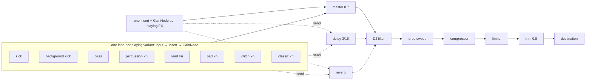
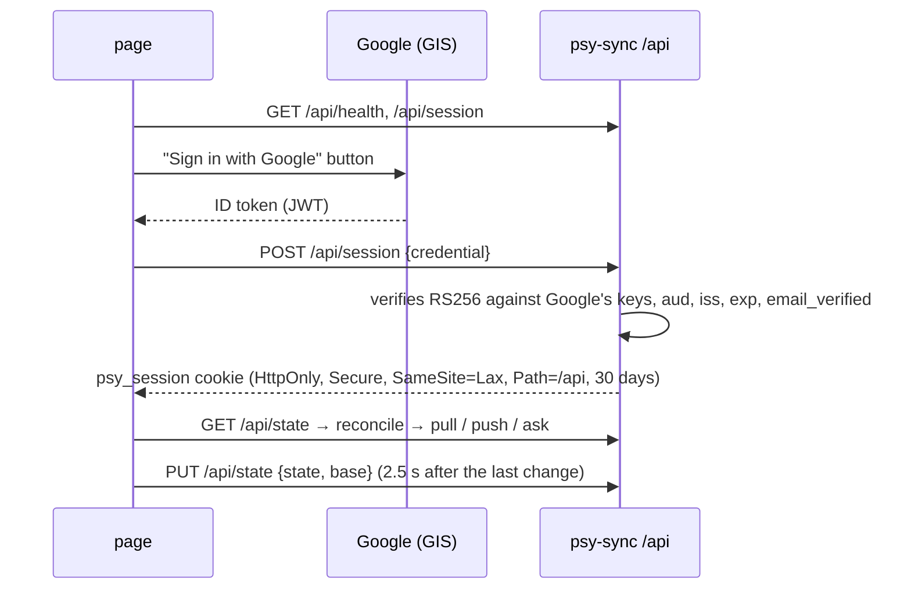

# psy-sampler

A live electronic music machine at `https://psy.agu.com.ar`. Each button loops a
layer (kick, bass, percussion, lead, pad, glitch; 9-15 sounds per layer) over a
grid of 32 sixteenths (2 bars), plus a layer of classics (hooks from famous
tracks) played by hand; FX are one-shots outside the loop. **Everything
is editable**: every button has a ▾ that opens its editor (steps, notes, synth,
knobs, filter and distortion), any sound can be duplicated and renamed, and a
signed-in user can upload samples to their profile and play any sound through
one. A DJ filter sweeps the whole mix. An autopilot builds a track
on its own in the chosen style (techno, progressive psytrance, psytrance,
psytech, hi-tech, goa, dark psy) from a shareable seed that also decides how each
sound sounds; its sections can be forced and queued, or planned by a language
model (✨ AI: Chrome's built-in one or an LM Studio endpoint, both on the
listener's machine, or the listener's own OpenAI, Anthropic or Google Gemini
account, linked with an API key). A second one, the snapshot autopilot, plays the user's
saved snapshots in order instead. What plays exports to WAV, as a loop or as a
live recording.
The UI is in Spanish, English and Portuguese. All audio is synthesized in the
browser with Web Audio (the pod only serves ~200 kB of static files), except the
users' own samples, which psy-sync keeps.

| Piece | Where |
|---|---|
| Code (Vite + vanilla JS, no runtime dependencies) | [`images/psy-sampler/`](../images/psy-sampler) |
| Cloud save (Bun + SQLite) | [`images/psy-sync/`](../images/psy-sync) |
| Chart (nginx) | [`charts/psy-sampler/`](../charts/psy-sampler) |
| Argo CD Application | [`apps/psy-sampler.yaml`](../apps/psy-sampler.yaml) |
| Image auto-update | [`psy-sampler-imageupdater.yaml`](../charts/argocd-image-updater/templates/psy-sampler-imageupdater.yaml) |
| CI | [`psy-sampler-test.yml`](../.github/workflows/psy-sampler-test.yml) (lint + tests + build), [`psy-sampler-image.yml`](../.github/workflows/psy-sampler-image.yml) (arm64 image → GHCR), [`psy-sync-test.yml`](../.github/workflows/psy-sync-test.yml) and [`psy-sync-image.yml`](../.github/workflows/psy-sync-image.yml) (the same for the API) |

## Audio engine



### Scheduler (lookahead)

| Parameter | Value | What for |
|---|---|---|
| `TICK_MS` | 25 ms | `setInterval` period |
| `LOOKAHEAD` | 120 ms | how far ahead of `ctx.currentTime` it schedules |
| `SAFETY` | 15 ms | nothing is scheduled closer than this (see Gotchas) |
| `FADE` | 30 ms | linear fade of a lane on a variant change (on the next step) or on Stop (right away) |
| `START_DELAY` | 60 ms | where step 0 lands on start |

Every tick reads `stepDuration(bpm) = 60 / BPM / 4`, so the slider applies live.
The next step's time is always the previous one + the duration in force when it
was scheduled, so a BPM change only stretches the steps from the cursor on:
what's already scheduled doesn't move and the grid doesn't drift. Measured in
Chromium (145 → 175 BPM): ~413 ms kick intervals, **one** in-between transition
beat (e.g. 378 ms = two sixteenths already scheduled at 145 + two at 175), then
~343 ms.

The pure logic (`collectSteps`, `nextBeatTime`) lives in
[`timing.js`](../images/psy-sampler/src/audio/timing.js), without Web Audio, and
is tested on its own.

### Changes on the bar line

`engine.onBar(fn)` registers a callback the scheduler calls right before queuing
the first step of each bar (steps 0 and 16), with its time. If it returns a map
of lanes, those lanes come in **exactly on that step**: no backfill, the old
lane fades out right there. An empty map fades everything out on the bar and
lets the timer wind down on its own. Everything that has to land on the grid
goes through it:

- **On the beat** (switch, on by default): while the loop runs, a click changes
  nothing yet; the new selection is queued (a pulsing dashed outline on what
  comes in, a pulsing fill on what goes out) and applies on the next bar.
  Clicking again before the bar cancels the queue. With the loop stopped, or
  the switch off, a click applies right away. **Double-clicking** a tile skips
  the wait: the second click (the event's `detail` 2) applies what the first
  one asked for right away and empties the queue; with nothing waiting it does
  nothing, so it never goes on-off-on.
- **⏺ Arm** (in the top bar, only while stopped) builds the start: armed, a
  click queues like "On the beat" does (a second click takes it back out, a
  double click counts once) and nothing sounds; **▶ Play** starts everything
  queued together from step 0, a queued snapshot included. Stop arms with
  what was playing queued (dotted) and hides itself, so ▶ Play sits in its
  slot and brings that mix back; the autopilot, armed, takes the queued mix
  and starts. FX still fire at once. The keyboard's play/pause and stop keys
  press the same buttons (`mediaKeys.js`, see *Gotchas*).
- **Autopilot** (see below), at every loop start.
- **Snapshot autopilot** (see Snapshots), on the loop start where a snapshot
  has played its bars.
- The editors' **🔀 Improvise**, at every loop start.
- The editors' **🎲 New part**, at the next loop start.
- The editors' **×2 hits**, **Reset** and **Reset hits / notes**, at the next
  bar line (see below).
- The kicks' **⏫ Build-up**: takes over the next bar and hands it back on the
  one after (see below).
- **Snapshots** (see below): a click plays the saved moment from the next bar,
  always, even with "On the beat" off.
- **💥 Drop** (top bar, next to Snapshot; only while the loop runs): armed, the
  next bar line starts a drop, the same one the autopilot plays into its peaks
  (see *Drops* below), with a riser fired on its first bar and an impact on
  the drop. A second click before that bar line disarms it. Under the
  autopilot it doesn't run on its own: it queues a Peak first and makes the
  section end after the next loop (`dropNext`), so that loop is the pilot's
  drop; ✕ on the queued Peak takes it back. Under the snapshot autopilot it
  is the drop by hand, over whatever snapshot plays.
- **BPM change** (in the top bar, next to the BPM slider): "BPM change [N]
  over [1-32 bars] ▶ Go" moves one linear stretch on each bar line (`rampAt`
  in `tempo.js`) and lands exactly on N on the last one. The in-between BPM goes to the engine with decimals, and rounded to the
  slider and to storage. The scheduler reads the BPM every tick, so each stretch
  comes in at most one step after the line. With the loop stopped there are no
  bars: it changes right away. Moving the slider, Stop, Tap or the same button
  cut it short.
- **Tap** (left of the BPM): tap along to another track, or psy-sampler on another
  device, and the loop locks onto it, tempo and phase (one browser runs one
  sampler: see [One tab at a time](#one-tab-at-a-time)).
  - The **first tap** of a count is the 1: `engine.restart()` takes the loop
    back to step 0 of loop 0 right there, like a fresh ▶ (the bar hook sees
    bar 0 again). The tap is already in the past when the handler runs, so the
    1 plays as soon as it safely can (`SAFETY`) and the steps after it fall on
    the grid that starts at the tap; every lane fades and reopens there, so
    the steps the old grid had queued inside the lookahead don't flam on top.
  - From the **second tap** on, `tapBeat` (`tempo.js`) fits one least-squares
    line through every tap of the count (the last 32 of them): the BPM is its
    slope, rounded to the slider, and `at` is where the 1 falls on it at that
    BPM. The app sets the BPM and `engine.align(at)` moves the cursor onto that
    grid (`alignCursor` in `timing.js`): the closest step, never back past the
    cursor. Notes already queued keep their time, so the seam is at most half a
    step off; a big tempo jump leaves a short hole there instead of doubling
    the steps the old grid already played. Each tap re-aligns, so the phase
    never drifts while you keep tapping.
  - **Precision** (Monte Carlo, taps scattered σ = 15 ms around 145 BPM): the
    fit lands on the exact whole BPM 46 % of the time after 8 taps, 92 % after
    16, ~100 % after 24; first-to-last (the old way, capped at 8 taps) topped
    out at 37 %. The 1 lands ~8 ms off on average after 8 taps, ~5 ms after 16. Whole
    BPM is the point: two psy-samplers, and most produced tracks, run at
    a whole BPM, so once it is right nothing drifts. A source at a fractional
    tempo (a pitched-up deck) drifts by the rounding until the next tap.
  - **Clocks**: taps are timed by the input event's `timeStamp`, not by when
    the handler runs (a busy main thread would jitter them), and mapped to
    the audio clock through `AudioContext.getOutputTimestamp()`, which pairs
    `performance.now()` with the sample leaving the speakers (output latency
    included); without it, `currentTime - outputLatency`. What stays out of
    reach: your own tapping bias (most people tap 10-40 ms ahead of the beat)
    and any latency the browser doesn't report (Bluetooth), both of which
    show up as a constant offset.
  - Half or double time works: a tempo far outside 60-180 moves by octaves
    and the 1 stays on the first tap. A 2 s pause starts a new count; a tap
    under 120 ms after the last is a bounce and is dropped. It counts on
    `pointerdown` and on the Space/Enter `keydown`, never on the click they
    cause. With the loop stopped, taps only set the BPM.

`triggerFx(id, at)` takes a time, so the autopilot fires FX on the same bar
line.

### Why lanes instead of cancelling notes

The old variant's notes that are already scheduled (up to 120 ms ahead) and the
long tails (pad, lead) aren't touched one by one: on a variant change the
**whole lane** fades out over 30 ms and a new one opens. The old notes play
inside the fade and die on their own.

- The new lane **backfills** the steps already inside the lookahead window
  (respecting `SAFETY`), so the new variant comes in on the next step instead of
  leaving a gap of up to 120 ms.
- The old lane's fade starts **on that same step**, not on the click: the change
  is a grid-quantized crossfade, with no silent gap between variants. `Stop`
  does cut right away (immediate fade).
- Long notes (pad, melodic lead, drone) entering mid-phrase start with what's
  left of them (`eventsAt(…, entering)`) instead of waiting up to 2 bars in
  silence. That holds for any note longer than one step, including the ones you
  write in the editor.

Selection → lanes is a pure reconcile
([`selection.js`](../images/psy-sampler/src/selection.js)): `desiredLanes()`
computes the desired state and `engine.setLanes()` closes/opens the difference.
**Kick and bass are exclusive** (one lane per layer: a second variant replaces
the first; two kicks or two basses only muddy things); **percussion, lead and
pad stack** (one lane per variant, `laneKey()`). **Ctrl+click** (⌘) stacks on
an exclusive layer anyway: the extra kick or bass gets a lane keyed by its own
id, like a stacking layer's, and a plain click there leaves just that one
again (`pressVariant`). So "is it playing" is `isOn()` (any lane), never
`active[laneKey()]`. Layers always combine: a
click toggles its variant and leaves the other layers playing. The background kick is a
derived lane: it only plays when another layer is on and no kick variant is
picked (stacked ones included).

### Delay and reverb

Post-lane sends (they follow the lane's fades) to two shared buses, with a
global switch in the transport (the return glides over 30 ms):

| | delay | reverb |
|---|---|---|
| percussion | — | 0.12 |
| lead | 0.3 | 0.25 |
| pad | — | 0.4 |
| glitch | 0.25 | 0.15 |
| classic | 0.3 | 0.25 |
| FX | 0.2 | 0.35 |

Kick and bass stay dry: a tail under them only muddies the low end. The delay is
**3/16** (a dotted eighth, the classic psy echo), feedback 0.38 through a
2.5 kHz LP (each repeat darker), and it follows the BPM with a 50 ms glide (a
jump in `delayTime` clicks). The reverb is a `ConvolverNode` with a synthetic
impulse: 2.4 s of stereo noise with a cubic decay.

### Filter, distortion and the DJ filter

Every sound carries an **insert** (`data.insert`,
[`insert.js`](../images/psy-sampler/src/audio/insert.js)) between its notes and
its lane gain: a filter, then a distortion. The editor shows it as "Filter and
distortion":

| | Options | Knobs |
|---|---|---|
| Filter | off, lowpass, highpass, bandpass, vowel | cutoff (log slider, 40 Hz-16 kHz), resonance, LFO depth (±2 octaves on `detune`), LFO every 1/8 … 4 bars, LFO shape, envelope (±4 octaves) and its decay |
| Distortion | off, saturation (tanh), hard clip, wavefold, bitcrush | drive |
| Modulation | phaser, tremolo | mix / depth, each with its rate (phaser 1/8 … 4 bars, tremolo 1/16 … 1/2) |
| Tone | always there | High-pass and Low-pass (log sliders, 20 Hz-20 kHz), open at either end |

- **Live**: knob moves glide (20 ms) on the playing lane. Switching a *type*
  needs other nodes, so the engine builds a fresh chain and crossfades it in
  over 30 ms (`swapInsert`), like a variant change.
- **The LFO** is an `OscillatorNode` locked to the BPM (`1 / (rate × step)`,
  re-glided on every BPM change) and starts on the lane's entry step, so the
  wobble starts on the grid. It is stopped when the lane fades.
- **Off is an identity**: a lowpass at Nyquist and a `WaveShaperNode` without a
  curve (both pass-through by spec), so a sound with nothing on sounds as before.
- **Level**: drive pushes harder into the curve and turns the output down
  (`driveGains`). Measured in Chrome on the acid lead, saturation, clip and
  wavefold stay within ±2 dB of the bypass from 0 to 100 % (wavefold needed its
  own correction: it read 2.6 dB hot at 0 % and 6.6 dB quiet at 100 %). Bitcrush
  goes from 8 bits (0 %) to 2 (100 %) at full scale and doesn't change the level.
- **Vowel** (Strudel's `vowel`): three bandpasses in parallel at A, E, I, O
  or U's formants, Q 4 + resonance, the LFO moving all three. Each vowel's
  levels carry its own makeup: measured in Chrome on the melodic lead, all five
  sit within ±0.5 dB of the dry sound.
- **LFO shape**: sine, triangle, saw, square (an `OscillatorNode`), or
  random (sample & hold) and smooth random, which loop a table at the LFO's
  rate: 8 values a cycle, 16 cycles before it repeats, from a fixed seed, so
  a WAV export wobbles the same way every time. A new shape builds a fresh
  chain.
- **Envelope** (`lpenv` / `lpdecay`): every note (and FX shot, and preview)
  calls the chain's `trigger(t)`, which pushes the filter's `detune` to
  ±4 octaves × the envelope in 2 ms and lets it fall back over the decay, on
  top of the LFO. It is mono-synth style, one filter per lane: the acid
  squelch on any sound.
- **Phaser**: 4 allpasses at 900 Hz in series, swept ±2 octaves by a sine,
  mixed with the dry signal and scaled by 1/√(1 + mix), which keeps it within
  half a dB. **Tremolo**: a gain swinging between 1 and 1 − depth (so it does
  lower the average level, ~3.7 dB at full depth). Both exist only while on,
  so switching either on or off builds a fresh chain.
- FX shots and the editor's previews get an insert too, and WAV exports render it.

- **Tone**: a highpass and a lowpass of the sound's own (`insert.hp` /
  `insert.lp`, Hz), after the distortion and before the modulation, apart from
  the creative filter above, so the autopilot can ride them without touching
  a filter you set. Unlike the rest of the insert they are always in the
  chain: open (hp at 20 Hz, lp at 20 kHz) they run at 0 Hz and at Nyquist,
  where the spec makes them identities, so a ride never swaps the chain (a
  crossfade every loop would smear it). Q 0 dB, which Web Audio reads as a
  linear Q of 1: a ~1.25 dB bump at the cutoff, no whistle. A knob glides
  (20 ms); the autopilot's ride is an exponential line over the loop
  (`update(insert, now, ramp)`), which can't touch 0 Hz, so it runs from and
  to 20 Hz and the identity is set at its end.

`lead.bits` ships with a resonant lowpass wobbling over 2 bars, to show it off;
every other factory sound starts with the insert off.

The **DJ filter** (transport) is one bipolar knob on the master bus, before the
compressor and after the effect returns: left closes a lowpass from Nyquist to
150 Hz, right opens a highpass from 0 to 6 kHz, both on a log scale with Q 1.2;
the centre is an identity (lowpass at Nyquist, highpass at 0) and has a small
detent; a double click recentres it. It is a performance control: never saved,
but carried across a remount and applied to WAV exports.

After it sits the **drop sweep**, a highpass of its own that only a drop
moves (`engine.sweep(at, end)` / `sweepOff(at)`), so it never fights your hand
on the DJ knob. At 0 Hz it is an identity. A drop runs it exponentially from
30 Hz to 900 Hz over its two bars, the low end draining out of the whole mix,
returns included. On the drop it glides back to 30 Hz over the last 15 ms
(a jump in a biquad's coefficients under a full mix can click) and opens to
0 Hz on the bar line. A drop that lands early (a BPM change) cuts the rise
where it is, as `pin()` does for a volume line. Q 0 dB: the bump passes the
kick's fundamental early in the rise, and more would feed the limiter. Stop
(or the loop running out) opens it as the lanes fade. Renders never have it;
a recording does.

A playing loop sound's **tile fill is its volume**: the fill covers `level /
1.5` of the tile (a tick marks 100 %), and dragging across it (or ← → on the
focused tile) sets the level in the editor's 5 % steps, live (`amountSlider`
in `ui/dom.js`, gated on the tile being on). The click still switches it off,
and a drag does not click. While it slides the subtitle shows the volume.
Only the level changes: an improvised part keeps its variation. Because the
pointer is the slider's, a playing tile cannot be dragged to reorder (a silent
one can, and Alt + arrows always work). FX and snapshot tiles keep a plain
fill.

A silent loop sound shows the same volume as a **thin bar** along the bottom
of its tile (`.level-bar`, a `role="slider"` sibling of the tile's button, not
inside it), so it can be set before the sound enters: a drag, a click on it or
← → on the focused bar. Its hit area is a strip, not the whole tile, so the
silent tile still drags to reorder. Once the sound plays the bar hides and the
fill takes over. Both read the same `--level` (see *Gotchas*: the bar's
`::before` has to inherit it by hand).

**🎧 solo** sits between 🔀 and ▾ on every loop sound: while it is held
(pointer captured, or Space / Enter down) only that sound is heard.
`engine.setSolo(id)` glides every other lane and FX shot to 0 (10 ms) and back
on release, and opens new ones silent meanwhile; nothing stops or reschedules,
so the rest drops back in on the grid, and delay and reverb tails already sent
ring out. The solo factor is applied only to live gains (`liveLane` /
`liveShot`), never to `render()`, so a WAV export taken mid-solo is the full
mix; a recording (which taps the output) does capture it. It does nothing on a
sound that is not playing, which would only leave silence, and one finger
cannot steal another's solo. A remount drops it.

**⊘ ban** is a small button in the top corner of every tile the pilot can play (FX too, not the classics), shown on
hover (always, faintly, on touch): it keeps that sound away from the autopilot
when it repeats too much. The banned ids live in the workspace (`banned`) and
`unbanned()` takes them out of the lists every pilot pick reads (`advance`,
`startPilot`, the bare-bar guard) and that the ✨ AI is offered and checked
against, so a layer whose whole style pool is banned sits out. The pilot
still draws its FX and then drops a banned one, so FX bans never shift the
seed; loop bans do (the pools are shorter), which is why they travel in
🔗 Share's `&s=`. Banned while the pilot plays it, the sound leaves on the next
bar line. By hand it still plays: it is the autopilot's ban, not a mute.

Each **layer volume** (the slider under a layer's name, 0-150 %) is a fader over
every sound in that layer, on top of each sound's own volume. It is not a node:
`engine.setLayerVolume` multiplies it into the level of the lanes and FX shots
of that layer, so the sends (after the lane gain) follow it, and changing it
glides the lanes that are playing (20 ms), the way a sound's volume does.
Auditions and WAV exports use it too. It lives in the workspace (`volumes`),
so it is saved and travels in presets, but snapshots and share links leave it
out.

## Editable data

What each variant plays is **data**, not code
([`patterns.js`](../images/psy-sampler/src/audio/patterns.js), `DEFAULTS`):

| Type | Data | Editor |
|---|---|---|
| `drum` (kick, percussion) | `steps`: 32 × off / hit / accent, `mods`: 32 × mod or null, + the voice's params | one row of 32 steps + knobs |
| `notes` (bass, lead, pad, toms) | `notes: [{step, midi, len, accent, ...mod}]`, `synth`, `params.bright`, `scale`, `transpose`, `len` | piano roll + synth + brightness + scale + octave + new-note length |
| `fx` | `params` (length in bars, range, decay…) | knobs + ▶ Fire |

All of them also have **Volume** (`level`, 0-150 % of their layer's level,
also set from the tile: see below),
**Reset**, the insert above (`insert`) and a **Source** (`sample`: `null` for
their own voice, or one of the user's samples, see *Samples*). `eventsAt(id, step, entering, data)` turns the data into events on
each step; `engine.setData(id, data)` replaces it and the scheduler reads it on
the next scheduled step (≤ 120 ms), without reopening the lane. A volume change
glides over 20 ms in the lanes playing that variant. Knobs (`params.js`) store
the voice's units (Hz, s, bars) and only format them for display.

Drums and notes also have **Reset hits** / **Reset notes**: only `steps` or
`notes` go back to factory, and the voice, knobs, insert, scale and volume stay.
A queued 🎲 New part is cancelled. If nothing else differed from factory, the
edit is forgotten (no ✎), the same as a full **Reset**. Both resets, like ×2
hits, land on the grid: while the loop runs they're queued (the button pulses)
and come in at the next bar line, another click before then cancels, and with
the loop stopped they apply right away. ■ Stop drops whatever was queued.

- **Click** on a step or cell: empty → hit/note → accent → empty. New notes are
  as long as "New note" says (shortened so they don't overlap the next one in
  the row or run past the end of the loop). **Dragging** with the mouse along a
  row paints a long note; on touch, dragging scrolls the piano roll and a tap
  adds a note.
- **Ctrl+click** (⌘ on a Mac) puts the clicked cell's new state on the same
  16th of every beat in its bar; **Ctrl+Shift+click**, of both bars
  (`cycleStepEcho` / `cycleNoteEcho`). In the piano roll it echoes the note's
  start, and a cell already inside a longer note is left alone.
- **Editing something that isn't playing switches it on**: what you edit is
  what you hear. Adding a note previews it right away (`engine.audition`), but
  only with the loop stopped: over the loop an off-grid note only cuts into
  what is playing.
- **🔀 Improvise** is a toggle and a slider on the same button. Click: while it's
  on, the part changes at every loop start (`varyNotes` / `varySteps` in
  `editing.js`: move a note to a nearby row, flip an accent, an echo a few steps
  later, or drop one; on drums only off-beat hits, the pulse never moves).
  Dragging across the button (or ← →) picks **how much** it changes, and the
  colour fill shows it: 0 % changes nothing, 50 % (the default) makes 1-2
  changes per loop, 100 % makes 6-7 and moves notes up to 3 rows
  (`changesFor`). A drag doesn't switch it on or off. The amount is saved per
  sound (`ws.improv`); the on/off state isn't. Every variation starts from
  **what you wrote**, not from the previous variation, so it breathes around
  the part without drifting away; variations only go to the engine, never to
  storage, and switching it off brings your part back. Each loop tile has its
  own 🔀 (above the ▾) that shows the state, switches it on or off without
  opening the editor, and fills up with the amount. It's a slider too: dragging
  it up or down (or the arrow keys) sets the amount without opening the editor,
  relative to where the drag starts (`TILE_SLIDE_PX` covers the whole range,
  since the button is tiny), and while it slides it shows the number in place
  of 🔀. Both buttons share `amountSlider` (`ui/dom.js`). **Reset** switches Improvise
  off and puts the amount back to 50 %.
- **×2 hits** (drums) adds a hit halfway between each hit and the next (wrapping
  around the loop): quarters → eighths → sixteenths. A one-step gap has no
  middle and stays as it is. It's an edit: it gets saved. While the loop runs
  it waits for the next bar line, like the resets above, and then doubles what
  is playing at that moment (an improvised variation included).
- **⏫ Build-up** (kicks only) sets up a roll for the next bar that keeps
  doubling the density: half a bar of quarters, a quarter of eighths and four
  accented sixteenths (`BUILD_UP` in `editing.js`). The toggle arms it (it
  switches the kick on if it wasn't playing, like any edit), it comes in on the
  bar line and on the next one it goes back by itself; pressing it again
  cancels it. It's a layer on top of what plays (`feed()` in `app.js`): your
  edits and Improvise's variations carry on underneath, and it never goes to
  storage.
- **🎲 New part** writes a new part in the chosen scale. While the loop runs it's
  queued (the button pulses) and comes in at the next loop start; another click
  before then cancels it; with the loop stopped it comes in right away. It
  follows the genre's habits per layer
  ([`editing.js`](../images/psy-sampler/src/editing.js)): a rolling bass between
  kicks, mostly on the root; a lead with an 8-step motif in A A' A B form; a pad
  with one triad per bar; sparse toms with a fill at the end.
- Scales in A: minor, **Phrygian** (B♭, the typical psy tension), harmonic minor
  and chromatic. Notes outside the chosen scale stay visible (in italics) so
  they can be deleted.
- **One editor open at a time**: opening one folds whichever was open, in any
  layer. It floats over the page like a context menu, as wide as its layer and
  just under its tile (`placeEditor`), so the rows below don't move; a press
  anywhere outside it or Esc closes it. In the column layout it is wider than
  its layer when the 32 steps need it (`min-width`), shifted left when it would
  leave the screen. While it is open a veil dims the page (`--veil`, darker in
  dark mode) and the tile being edited sits above it with an outline; the veil
  lets clicks through, so the other sounds still play live. The grids have a bar header (1, 2) and a beat header (1-4), beats 2 and
  4 shaded, and a rule between the two bars.
- **Foldable sections.** *Filter and distortion*, *Modulation*, *Groove and
  space* and *Pattern* are `<details>` (`fold` in `editor.js`), folded by
  default; the header, the source, the voice's sliders, the Click row, the grid
  and its actions never fold. Which ones are open is app state shared by every
  editor (open Pattern on the kick and it is open on the bass too), carried
  across a remount and kept per browser in its own `localStorage` key
  (`psy-sampler:folds`, not the workspace: it never reaches the cloud or a
  share link). A section that still changes the sound shows an **on** pill in
  its summary, folded or not, so folding never hides a filter that is on
  (`foldActive` in [`folds.js`](../images/psy-sampler/src/folds.js)). It means
  off the NEUTRAL value, not off the factory's: `lead.bits` ships with a
  lowpass, so it is flagged, while the knobs of a filter that is off are not.
  The autopilot's tone ride flags the insert while it closes the filter.

### Mods: chance, condition, ratchet

Borrowed from [Strudel](https://strudel.cc)'s `sometimes` / `every` / `ply`
(and Elektron's trig conditions): any hit or note can carry a **mod**, `{ p,
cond, ply }`, each key stored only when it is not the default (`cleanMod` in
`patterns.js`). Drums keep them in `mods`, parallel to `steps`; a note carries
them as its own fields.

| Key | Values | What it does |
|---|---|---|
| `p` | 0.9 / 0.75 / 0.5 / 0.25 / 0.1 (Strudel's almostAlways, often, sometimes, rarely, almostNever) | the chance it plays on each loop |
| `cond` | `a:b` with b = 2, 4, 8; `!a:b` | plays only on loop a of every b (`!`: on every other loop). Loops are 2 bars, counted from ▶ (the first is 1) |
| `ply` | 2, 3, 4 | a ratchet: the hit repeats n times inside its step; a note splits into n inside its length |

- **The chance is not `Math.random`.** `passes()` draws from a hash of the
  sound's id, the loop and the step, so a restart replays the same loops, a
  share link and a WAV export sound the same, and a chord (same step) drops as
  one. A copy (`~n`) draws its own.
- **The loop counter** lives in the scheduler's cursor (`collectSteps` in
  `timing.js`), so it survives a throttled tab skipping steps. A WAV render keeps
  its second pass, so it renders that pass as the first loop after ▶ and the
  warm-up before it as the last of every b.
- Ratchets are events with an `offset` in steps, added to the step's time by
  the engine. A lane joining mid-note plays the rest as one note.
- **In the editor**, a **Click:** row over the grid picks what a click does:
  **✏️ Write** (the default, the plain hit / note cycle) or 🎲 Chance, 🔁
  Condition, ⚡ Ratchet with a value. A mod click on a hit or note sets that
  key, the same value again takes it off, an empty cell gets a new hit or note
  carrying it, and Ctrl (+ Shift) echoes it like a plain click. **Apply to
  all** puts it on every hit or note (or takes it off all of them when they
  all have it), **Remove modifiers** takes every mod off the sound, and **↺
  Reset** (shown once the row moves off its default) goes back to Write and
  the factory values. The row is app state shared by every editor, carried
  across a remount, never saved. A cell with a mod is striped when it may not
  play and tagged with its condition, else its ratchet, else its chance (the
  tag is out of the flow, so it never sizes the cell); the title lists them
  all.
- A mod lives on a hit: writing a hit away drops it (`pruneMods`), and so does
  `sanitize` for a mod on an empty step. *Reset hits* resets them with the
  steps, the build-up bar plays without them, and the tiles' flashes skip what
  a mod leaves out.

### Pattern: speed, iter, echo and part edits

The editor's **Pattern** box, after Strudel's pattern functions:

| Control | Data | What it does |
|---|---|---|
| Speed | `speed`: 0.5 / 1 / 2 | `slow(2)` / `fast(2)`: ×2 plays the part twice per loop (odd steps land half a step in), ×½ stretches it over two loops |
| Iter | `iter`: 1 / 2 / 4 / 8 | `iter(n)`: each loop starts 1/n further into the part, back to the start every n loops |
| Echo | `echo`: null or `{ steps, semis }` | `off(t, add(semis))`: every hit or note again `steps` 16ths later, unaccented, without a ratchet; notes transposed (`semis` is always 0 on drums) |
| ◀ 1/16, 1/16 ▶ | | `early` / `late`: rewrites the part a 16th earlier or later, wrapping; right away, like a grid click |
| ⇆ Reverse | | a retrograde around step 0 (step s → −s), so beats stay beats and offbeats stay offbeats; notes keep their length and get trimmed so a row never overlaps (`tidy`) |
| Euclidean (drums) | | `euclid(k, n)` / `euclidRot`: Bjorklund's k hits over n steps (the same strings as Strudel: 3/8 is the tresillo), repeated across the loop; an n that doesn't divide 32 runs against the bar and restarts on the loop. It replaces the hits and their mods |

Speed, iter and echo only change how `eventsAt` reads the part
(`positionAt` / `readsAt`), so the written part is untouched and they are
saved with the sound. A part read out of place never plays past the loop end,
and at each loop start it joins whatever its new position is in the middle of
(the same "entering" rule a lane uses), so a ×½ pad holds across both loops.
⇆ and Euclidean rewrite what plays now, an improvised variation included,
and wait for the bar line like ×2 (`reshape` in `app.js`); like any edit they
switch a silent sound on. The euclid's k / n / rot are app state like the
Click row. *Reset hits / notes* puts speed, iter and echo back too, and the
kick's build-up bar plays in place, without them.

### Groove and space: swing, nudge, duck, pan

The editor's **Groove and space** box (FX get only its pan half):

| Control | Data | What it does |
|---|---|---|
| Swing | `swing`: 0-0.5 of a step | every odd 16th lands that much later (`eventsAt` adds it to the events' `offset`); shown MPC style, 50 % straight to 75 %, 66 % ≈ a triplet feel |
| Nudge | `nudge`: ±30 ms | every hit of the sound earlier or later; the engine adds it to the time and never schedules closer than `SAFETY` |
| Duck | `duck`: 0-1 | sidechain to the kick (Strudel's `duckorbit`); not on kicks |
| Pan | `insert.pan`: −1..1 | a `StereoPannerNode` at the end of the insert, only while panned (see below) |
| Autopan | `insert.width`, `insert.panRate` | a tempo-synced sine on the pan, like the filter LFO; switching it on or off builds a fresh chain (`kindOf`) |

**Pan is not free at the centre.** A `StereoPannerNode` spreads a mono input
equal-power, so at pan 0 it leaves each side at ×0.707 (−3 dB): every
synthesized sound would lose 3 dB just by having one. So an unpanned sound
(pan 0, no autopan) has no panner and its chain stays an identity, and a
panned one gets √2 after the panner: unity at the centre again and constant
power across a sweep. Moving the pan off 0, or back, swaps the chain with
the usual 30 ms crossfade. A stereo sample, panned, comes out 3 dB hotter.

**The sidechain is audio, not scheduled envelopes**, so it follows any kick
pattern (ratchets, the background kick, a build-up) and renders into WAV
exports the same way. Every kick lane's gain also feeds a sidechain input →
a `WaveShaper` that rectifies and clips (`min(1, 8·|x|)`, so the kick's whole
body reads as full) → a 2-pole 8 Hz lowpass with Q 0.5 (no overshoot) → the
envelope. Each lane has a **ducker** gain between its insert and its lane gain;
with `duck` > 0 the envelope goes through a `-duck` gain into the ducker's
`gain` param, so the lane plays at `1 − duck × envelope`. A kick never ducks
(kick → sidechain → kick would be a cycle with no delay, which Web Audio mutes).
Measured in Chrome on an offline render, a pad at duck 0.9 under the punchy
kick at 145 BPM drops to 0.27-0.43 of its level (run to run) 40-80 ms after each kick and is
back by ~150 ms, well before the next beat (414 ms).

### Custom sounds: duplicate and rename

**Duplicate** (in the editor) creates a copy right next to the original, opens
it and leaves the name selected to type a new one. A copy has id `<base>~n`
(`kick.punchy~2`): `baseOf()` / `defOf()` in `patterns.js` resolve type, voice,
range and FX through the base, so the engine, the editor and `sanitize` can't
tell copies from originals. The copy starts with the original's current data and
is independent from then on. The **Name** can be edited live on any sound
(factory ones too); empty goes back to the default name. Only copies can be
deleted (**Delete sound**).

### Ordering

Each layer has a ⠿ handle: dragging it moves the whole layer (or ↑ ↓ with the
handle focused). Tiles drag within their layer: with a mouse after moving 6 px,
on touch after a long press (350 ms), so a swipe still scrolls and a tap is still
a click; with the keyboard, Alt + arrows. Dropping never fires the sound's click.
Generic, in `ui/sortable.js`.

### Snapshots

**📸 Snapshot** (in the top bar, next to Stop) saves what plays as a moment of
the track, in the **Snapshots** panel. That panel is one more layer: it reorders
with its handle and starts at the end. A snapshot (`snapshots.js`) saves:

- **what plays**: the engine's lanes. The background kick becomes the kick it
  is, so it sounds the same even if "Background kick" is switched off later.
- **how it sounded**: the data of each of those sounds, as it sounded in that
  loop (with Improvise's variation, without the build-up). If you edit the bass
  afterwards, the snapshot brings back the bass from then.
- **the moment of the track** (intro, groove, build-up, peak, breakdown). With
  the autopilot running it's the section it's in. Otherwise `guessSection()`
  guesses it from the mix: no kick and a lead or pad → breakdown; kick + pad →
  peak; kick + lead → build-up; with bass → groove; otherwise intro. The default
  name is that section ("Peak", "Peak 2"…).

Taking one opens its editor with the name selected. **Clicking** the snapshot
queues it (dashed outline) and it comes in on the next bar: the selection
becomes its own and its data goes back into its sounds (that's an edit of those
sounds: it gets saved, and if it matches the factory data they show no ✎).
Another click before the bar cancels; a double click comes in right away; with
the loop stopped it comes in right away. With the **autopilot** running, it also
takes it to the snapshot's section and carries on from there.

**🎞️ Snapshot autopilot** (in the autopilot row, next to 🤖) plays the
snapshots one after another, in the panel's order, and starts over after the
last one: drag the tiles to arrange the track. Nothing in it is random, so the
same list plays the same way every time.

- **How long**: each snapshot plays the bars the **Changes** slider says (2-32)
  and the next one comes in on a **loop start**, so a change never cuts a 2-bar
  loop in half. A snapshot that came in mid-loop (a click lands on any bar line)
  plays one bar more. The slider applies to the snapshot already playing.
- **What it plays**: exactly the snapshot, through the same `load()` as a click
  (its selection and its data). It fires no FX, writes no melodies, dresses no
  sound and doesn't ride the faders: that is the 🤖 autopilot's job. Like it,
  it keeps the background kick out, so a Breakdown snapshot stays kickless.
- **Where it starts**: the queued snapshot (by hand or armed), else the one
  playing (it carries on from it, counting from the next bar line), else the
  first. From silence it starts at once.
- **By hand**: clicking a snapshot plays it from the next bar and the tour carries
  on from it. A click on a sound changes the mix until the next snapshot (on the
  line where both fall, the hand wins and the snapshot waits a loop).
  **⏭ Next** moves on on the next loop start. The row shows the snapshot playing,
  its bars left and the one coming next, which pulses (and its tile, dotted) in
  the last loop.
- It needs two snapshots. 🤖 and the section buttons switch to the other
  autopilot; Stop switches it off. Removing the snapshot playing goes on to the
  one after it; removing the last one switches it off.

The logic is pure (`startTour`, `countBar`, `tourDue`, `tourLeft`,
`nextSnapshot` in `snapshots.js`); the UI drives it from the bar hook.

The **editor** (▾) works on a **draft**: name (Enter saves), moment, remove a
sound (✕), add one (takes how it sounds now; on kick or bass it replaces the one
there was) or **📸 Capture what plays** to replace them all. Nothing changes
until **Save**, and **Discard changes** goes back to what's saved. The draft
survives closing the panel and a language change (the tile shows "•"), but not
a page reload. **▶ Try** plays the draft from the next bar without saving it.
Deleting a sound copy removes it from the snapshots, and a snapshot left with no
sounds disappears.

**🔗 Share** (in the editor) copies a link to that snapshot alone:
`#snap=…`, a snapshots file holding just it (the same `toSnapshotFile()` as
⬇ Export, so the names of the copies it plays travel too), deflated and
base64url like the sounds of a seed link (`snapFragment()` in `share.js`).
It takes what the editor shows, unsaved changes and an emptied name (back to
its moment) included, like ▶ Try; with no sounds it is off. One with a kick
and a lead measured ~750 characters. Opening it is an **⬆ Import** of that file
(`importSnapshots()`): the snapshot goes after yours, a copy it plays comes
along, and one you already have (same moment, sounds and data, whatever its
name) adds nothing. It does not touch what plays nor your sounds, clears the
fragment and says to click it: audio needs that click. BPM, layer volumes and
samples stay out, as in the file.

**⬇ Export** (in the panel) downloads the snapshots alone as
`psy-layers-snapshots.json` (`kind: "snapshots"`, plus the names of the copies
they play). **⬆ Import** takes that file, or a whole preset, and **adds** its
snapshots after the ones there (`importSnapshots()` in `workspace.js`): they are
renumbered, a repeated name gets " 2", and a snapshot that already exists with
the same moment, sounds and data is skipped, so importing the same file twice
adds nothing. A copy a snapshot plays comes along when the workspace lacks it;
if the workspace uses that id for a copy with another name, it arrives as a
fresh copy (`~n`). Past `SNAP_MAX` the rest stay out, and so do their copies. A
user sample travels as its id only: in another account the sound plays its own
voice.

### What gets saved

Everything lives in one object, the **workspace** (`workspace.js`), in
`localStorage` (`psy-sampler:v2`, per browser): BPM, the switches, the order of
layers and tiles, the copies, the names, the edited data, the snapshots, the
length of the BPM change, the seed, the autopilot's style and changes, each
sound's Improvise amount, the sounds banned from the autopilot, and the language. The ✨ AI's settings live apart, in
`psy-sampler:ai` (API keys included, so they never leave the browser). The only thing not saved is what's
playing (a page load starts silent: no audio without a click). `normalize()` is
the only way in, for storage and for an imported preset: it checks every field
and whatever doesn't add up goes back to the factory value, so old, hand-edited
or foreign data never breaks the loop. Without storage (private mode) it works
the same, without remembering.

**Reset sounds** (with a confirmation) does what each editor's **Reset** does,
for every sound at once: edits, melodies, improvise amounts and the autopilot's
parts go back to factory, copies keep their place with their base's factory data,
and every sound is deselected: the loop and the autopilot stop. Snapshots carry their own data, so they are untouched;
so are the layout and the settings. Ticking **Factory** next to it turns it into
**Reset everything**, which puts everything back to factory except the language.

### One tab at a time

Two tabs in one browser would play over each other and save over each other's
workspace, so one browser runs one sampler (`tabs.js`). The tab in use holds a
Web Lock (`psy-sampler:tab`). A new tab finds it held, asks the holder over a
`BroadcastChannel` whether it is playing, and shows "Another tab is playing"
(or "is open") instead of mounting the app: **Use this tab** steals the lock,
and only then does the app mount, reading the workspace fresh. The tab that
lost the lock learns it from the `AbortError` on its request: it stops, uploads
what's pending and reloads into the same question, so either tab can take it
back. Edits are already in `localStorage` by then (every change saves at once),
so nothing is lost. Another browser, device or private window is another
sampler, which is the way to Tap two together. Without Web Locks the guard is
off and tabs behave as before.

### Export

- **⬇ Mix audio**: a 2-bar WAV of what plays. **⬇ WAV** in each editor: that
  sound alone (for FX, the one-shot with its tail). `engine.render()` builds the
  same output chain in an `OfflineAudioContext` at 48 kHz; a loop is rendered
  **twice, keeping the second pass**, so the tails from the end are already
  wrapped into the start and the file loops seamlessly in any DAW. An FX renders
  its longest length at the slowest BPM plus a tail (21 s:
  `FX_RENDER_SECONDS`) and is trimmed at silence (-80 dBFS). 24-bit stereo (`audio/wav.js`).
- **● Record** (top bar): records what reaches the speakers, live, and downloads
  `psy-layers-<date>-<time>.wav` on stop. Pressed, it waits for sound and the
  take starts on the first sample above -80 dBFS; the silence after the last
  sound is trimmed. `engine.tap()` connects an AudioWorklet
  (`audio/tap.worklet.js`, loaded as its own file via `?url&no-inline`) after
  the output trim, so the DJ filter, FX, auditions and the limiter are all in
  it, at the context's own sample rate. `audio/take.js` encodes 24-bit PCM as
  blocks arrive and folds it into a Blob every 16 MB, so memory holds about the
  file's size, not the floats. **Capped at 15 min** (`MAX_SECONDS` in
  `audio/recorder.js`, ~260 MB at 48 kHz: a whole track, and still safe in a
  phone's tab); at the cap it stops and downloads on its own. The recorder
  lives as long as the engine, so a language switch or an import doesn't cut
  the take.
- **Export / Import preset**: the workspace (snapshots included) + what plays,
  as JSON (`app: "psy-sampler"`). Importing replaces it entirely and plays its
  mix. Shared links carry only the sounds, not the snapshots. The snapshots
  alone travel through the panel's own Export / Import, and one at a time
  through its editor's 🔗 Share (see Snapshots).

## Cloud save

Anyone with a Google account can save their workspace on the server and use it
on another device. The state is **always visible** in the top bar
(`ui/account.js`), next to the link back to agu.com.ar and the language:

| Pill | When |
|---|---|
| ☁ Cloud… | still asking the API |
| ☁ Cloud unavailable (grey) | the API doesn't answer; retried every 30 s, everything stays in the browser |
| ☁ This browser only (grey) + Google button | signed out |
| ☁ Unsaved changes… / Saving… (amber) | signed in, uploading |
| ☁ Saved ✓ hh:mm (green) | signed in, the cloud matches this browser |
| ☁ Offline / Could not save / changes from another device (red) | signed in, something failed |

Signed in, the avatar opens a menu with the email, **Sign out** and **Delete my
data**. If Google's script doesn't load (blocker, no network) it reads
"Sign-in unavailable" instead of leaving a gap. On a phone the bar takes two rows
and isn't sticky.

The Google button is an iframe with a light document inside: if the iframe's
`color-scheme` doesn't match that document's, the browser paints it an opaque
white background. That's why `.gsi-slot` forces `color-scheme: light`, and in
dark mode the button (`filled_black`) shows without the white box.



**Why not oauth2-proxy**: the cluster's `google-auth` is an allowlist that opens
the dashboards (Traefik, Grafana, Pi-hole, Shelly, logs); opening it to any
email isn't an option, and a second oauth2-proxy means another deployment,
another cookie, and redirects a `fetch` doesn't follow. Instead the page uses
*Sign in with Google* (the same OAuth client as agu.com.ar), and the API verifies
the token itself and issues its own session cookie.

**API** ([`images/psy-sync`](../images/psy-sync), Bun with no dependencies:
`bun:sqlite` + WebCrypto):

| Route | |
|---|---|
| `GET /api/health` | `{ ok, clientId }`: the page decides whether to show the cloud row |
| `POST /api/session` | `{ credential }` → cookie |
| `GET /api/session` | `{ email }` (`null` when signed out: not an error on every visit); records the `X-Psy-Visitor` header |
| `DELETE /api/session` | sign out |
| `GET /api/state` | `{ state, updatedAt }` or 404 |
| `PUT /api/state` | `{ state, base, force? }` → `{ updatedAt }`, or **409** with the stored copy when `base` is stale |
| `DELETE /api/account` | deletes the user and their workspace |
| `POST /api/stats` | `{ visitor, played?, recordings?, … }`: usage since the last report, added to the browser's day (see *Usage* below) |

- The server **doesn't interpret** the workspace: it stores an opaque JSON
  object (capped at 256 KB) and the page runs it through `normalize()` when
  fetching it, like a preset.
- Samples have their own routes (see *Samples* below).
- Writes: on top of `SameSite=Lax`, the `Origin` header must be
  `https://psy.agu.com.ar`.
- The session is a stateless HMAC (`sub.expiry.signature`); the key is generated
  on first boot on the volume, next to the database: **no Secret to create**.
  Deleting the account deletes the user's row, and a cookie for a user that no
  longer exists opens nothing.
- Caps: `sync.maxUsers` (5000 accounts; existing ones keep signing in) and a
  Traefik `rateLimit` per real IP (`Cf-Connecting-IP`, like Home Assistant) on
  the `/api/` route.

**Sync** ([`cloud.js`](../images/psy-sampler/src/cloud.js)): each browser
remembers, per account, the `updatedAt` and a content hash of the last sync
(`psy-sampler:cloud`). On load:

| Cloud | Here | What it does |
|---|---|---|
| empty | | uploads what's here |
| same content | | nothing |
| where I left it | no changes / changes | nothing / uploads |
| newer | no changes (or factory) | downloads it |
| newer | changes | **asks** (OK = the cloud's, Cancel = overwrite it with this one) |

Each local save uploads 2.5 s after the last change, with `base` = the version it
was built on; a 409 (another device saved in between) asks the same question.
Hiding the tab uploads anything pending with `keepalive`. Offline, it stays local
and uploads with the next change.

### Samples

A signed-in user uploads audio in the **🎵 Samples** panel (under the tools,
collapsed): loose files, a folder (**📁**, or dropped on the panel) or archives.
They are kept **on the Pi**, in the user's profile: BLOBs in the same SQLite
file, so deleting the account takes them along.

| Route | |
|---|---|
| `GET /api/samples` | `{ samples: [{ id, name, type, bytes, createdAt }], used, limits }` |
| `POST /api/samples?name=…` | the raw file → **201** `{ id, … }`; **413** too big, **415** not audio, **507** no room (`error`: `quota`, `count` or `full`) |
| `GET /api/samples/:id` | the file, to its owner only (anyone else gets 404); `immutable`, `nosniff`, `attachment` |
| `DELETE /api/samples/:id` | 204 |

#### What it imports

[`src/import/`](../images/psy-sampler/src/import) turns a selection into a flat
list of candidates (`gather.js`), each read only when it is auditioned or
uploaded. A lone audio file goes straight up; anything more (or a project file)
opens a picker: ▶ to audition, a checkbox per sample, preselected up to the slots
the account has left.

| Source | Read by |
|---|---|
| MP3, FLAC, AAC/M4A, Ogg Vorbis/Opus, WebM | the browser's `decodeAudioData` (open-source Chromium has no AAC; Chrome does) |
| WAV: 8/16/24/32-bit, 32/64-bit float, A-law/μ-law, `WAVE_FORMAT_EXTENSIBLE`, BWF, **RF64/BW64** | the browser, else `pcm.js` |
| **AIFF/AIFC** (`NONE`, `twos`, `sowt`, `in24`, `in32`, `fl32`, `fl64`, `alaw`, `ulaw`), **CAF** (`lpcm`, `alaw`, `ulaw`), Sun **.au/.snd** | `pcm.js`: Chromium and Firefox decode none of these |
| **SoundFont .sf2** (16/24-bit, linked L/R pairs joined) and **.sf3** (MuseScore: one Ogg Vorbis stream per sample) | `soundfont.js`: one candidate per sample, sliced out of `smpl` on demand |
| **.zip** (ZIP64 too), and zips under other names: Bitwig `.multisample`, Renoise `.xrni`/`.xrns`, Decent Sampler `.dslibrary` | `zip.js`: reads the central directory, inflates each entry on demand (`DecompressionStream`), opens a zip inside a zip |
| **Ableton Live** `.als` `.alc` `.adg` `.adv` | `projects.js`: gunzips the XML; marks the files the set uses, and a Simpler/Sampler zone with its own start/end becomes a **slice** |
| **SFZ**, **Decent Sampler** `.dspreset`, **REAPER** `.rpp` | `projects.js`: the `sample=` / `path="…"` / `FILE` references |

`pcm.js` was checked bit-exact against ffmpeg's float decode for every codec
above; `soundfont.js` against a GM bank (488 samples) and MuseScore's SF3.

Every extension lives in one table,
[`formats.js`](../images/psy-sampler/src/import/formats.js) (audio, archives,
instruments, projects, closed): `gather.js` sorts files by it, the file dialog's
`accept` comes from it, and the panel's **ⓘ Formatos admitidos** (collapsed,
shown signed in or out, with the per-sample limits) lists it, so what the page
says it reads is what it reads. A new format is one line there.

- **Project files only point at samples.** A page can't follow a path on disk,
  so the samples must come in the same selection: pick or drop the **project
  folder** (or a zip of it). A reference matches by file name, preferring the
  file whose folders agree with it; what isn't there is listed as missing. In
  Live, **File › Collect All and Save** copies every sample into the project
  folder first. Sets under `Backup/` are skipped (stale references).
- The Ableton XML is not a published format. `projects.js` reads what Live 9-12
  write: `<SampleRef><FileRef>` with `RelativePath`/`Path` values (Live 11+) or
  `RelativePathElement`s + `Name` (earlier), and `SampleStart`/`SampleEnd`, in
  frames of the file, in a `<MultiSamplePart>`. Audio clips import whole: their
  markers are in beats once warped.
- **Not supported**, and named in the message so the user exports to WAV: REX
  (`.rx2`), Kontakt (`.nki`, `.ncw`…), Reason ReFills, FL Studio `.flp`, Logic
  `.logicx`/EXS, Cubase, Pro Tools, Bitwig projects, Maschine, Ableton `.alp`
  packs. Nor ADPCM WAV, ALAC, WMA, APE/WavPack/DSD, 7z/RAR, encrypted zips.
- Clutter in folders and archives (`.asd`, `__MACOSX/`, `._*`, artwork, docs,
  MIDI) is skipped quietly; the list stops at 500 candidates.

#### What goes up

- **Checked twice.** The page decodes every candidate before sending it (the
  browser's decoder, then `pcm.js` for what it refuses): what runs longer than
  15 s (`MAX_SECONDS` in [`samples.js`](../images/psy-sampler/src/samples.js)),
  or a source over 64 MiB, never leaves the page.
- **Stored as it came** only when every browser decodes it and it fits the
  per-file limit: plain WAV (8/16/24-bit PCM or 32-bit float, not extensible),
  FLAC, MP3, AAC/M4A (not ALAC). **Everything else goes up as WAV**: AIFF and
  CAF (Safari only), Ogg/WebM (not in every Safari), RF64, G.711, 64-bit float,
  SoundFont samples, Ableton slices. At 48 kHz (the decoding context's rate),
  24-bit when it fits the per-file limit, 16-bit otherwise: 15 s of stereo only
  fits the 3 MiB default in 16. So a sample plays wherever its owner signs in. A
  float file over full scale comes in scaled down to it, not clipped.
- Samples stored before this (an AIFF uploaded from Safari) still play in
  Chrome: `load()` falls back to `pcm.js` as well.
- The server trusts none of it: the bytes must start like WAV, AIFF, OGG, FLAC,
  MP4, WebM, MP3 or AAC (`sniffAudio`), and the stored `content-type` is the
  sniffed one. Its list didn't change: the page never sends it anything else.
- **Limits** (`sync.samples`): 3 MiB per file, 24 samples and 100 MiB per account,
  and **1 GiB for everyone together**: that shared cap, not the number of
  accounts, is what keeps uploads off the SD card's free space (local-path
  doesn't enforce the PVC size). Alert `PsySyncSamplesNearCap` at 80 %.
- **Ids** are 16 random bytes in base64url. The workspace refers to a sample by
  id (`sample: { id, name, pitch, start, length, reverse }`), so shared links
  and presets travel without the audio.
- **Playing one.** In any editor, **Source** picks the sound's own voice or a
  sample; with a sample, the voice's knobs become Pitch (±24 semitones), Start
  and Length (fractions of the file) and Reverse. A hit or an FX plays the
  sample out; a note transposes it from **A3** (where it plays as recorded) and
  lasts as long as the note. Every playback gets 2-6 ms fades, so a slice cut
  mid-waveform doesn't click.
- **+ Sound in…** (in the panel) makes a new sound in a layer from a template
  (`SAMPLE_TEMPLATES` in `catalog.js`): the kick's quarters, the clap's 2 and 4,
  the bass's offbeat (transposed +2 octaves, back around A3), the melodic lead
  (−1 octave)…, named after the sample, with its editor open.
- **Fallback.** Samples are decoded on demand (the ones the sounds and snapshots
  use, plus previews), off the live context in an `OfflineAudioContext`. Until a
  sample is decoded, and whenever it can't be (signed out, another account, a
  shared link, a deleted file), the sound plays **its own voice**: a sample
  event keeps it as `fallback`. Deleting a sample switches the sounds using it
  back to their voice.
- The decoded audio lives in memory for the session; nothing is cached in the
  browser's storage.

**Infra** (in the `psy-sampler` chart, `sync.*` in `values.yaml`): a separate
Deployment (if the API is down, or its image isn't public yet, the static site
keeps working and the page hides the cloud row), `strategy: Recreate` (SQLite on
an RWO volume), a 2 Gi PVC on `local-path` with `helm.sh/resource-policy: keep`
and `Prune=false`, a non-root container with a read-only root filesystem and no
capabilities.

The `/api/` rate limit is 120 requests/min per IP with a burst of 60: a page load
fetches every sample its sounds use on top of the usual calls.

Metrics, dashboard and alerts (accounts, anonymous browsers, usage, disk per
account, samples, visitor countries):
[monitoring.md#psy-sampler-cloud-save](monitoring.md#psy-sampler-cloud-save).

**Usage.** `src/stats.js` reports, keyed by the same visitor id as the session
check: whole seconds the loop ran (`engine.playedSeconds()`, by the audio
clock; FX shots and previews alone do not count) and a count of WAV takes (plus
their seconds), WAV renders, preset and snapshot exports, share links and
autopilot starts (a new seed under a running autopilot is not a start). It sends
every 5 minutes and when the tab is hidden, with `keepalive`; a report that
fails to leave goes out with the next one. Nothing else about the session leaves
the page. psy-sync sums each report into one `usage` row per browser per UTC day,
so the table grows by ~100 bytes per active browser per day; rows older than 400
days are pruned. Anyone can POST, so each report is clamped (1 h of play, 50 of
each count), a day is capped (24 h, 1000), the browser must already be known
from a session check, and new rows stop at 5000 browsers a day.

### One-time setup

1. Google Cloud → APIs & Services → Credentials → the agu.com.ar OAuth client →
   **Authorized JavaScript origins**: add `https://psy.agu.com.ar` (and
   `http://localhost:5173` for development). Without it the Google button
   doesn't load ("origin is not allowed for the given client ID").
2. Merge; wait for `psy-sync-image.yml`; GitHub → Packages → `psy-sync` →
   **Public** (same as `psy-sampler`). Until then the API pod sits in
   `ImagePullBackOff` and only the cloud row is missing.

### Data and backups

The database (`psy-sync.db`) and the session key live on the PVC, on the Pi's
SD card. **There's no automatic backup**: losing the card loses the accounts and
what's saved in the cloud (each browser keeps its local copy, which uploads
again on the next visit). To copy it by hand:
`kubectl -n psy-sampler exec deploy/psy-sampler-sync -- cat /data/psy-sync.db > psy-sync.db`
(with WAL, prefer `sqlite3 .backup` if a consistent copy under load is needed).

### Development

```bash
cd images/psy-sync && bun test
DATA_DIR=/tmp/psd GOOGLE_CLIENT_ID=<client> ALLOWED_ORIGINS=http://localhost:5173 bun src/server.js
cd images/psy-sampler && npm run dev   # Vite proxies /api to :8787
```

## Autopilot and seeds

**🤖 Autopilot** (`autopilot.js`) walks through the sections of a track and
decides at every loop start what plays:

| Section | Bars | Kick | Bass | Perc | Lead | Pad | Glitch | On entry |
|---|---|---|---|---|---|---|---|---|
| Intro | 8 | 1 | – | 1 | – | 1 | – | |
| Groove | 8 or 16 | 1 | 1 | 1-2 | 0-1 | 0-1 | 1 | sometimes a siren; 25 % new bass |
| Build-up | 8 | 1 | 1 | 2 | 1 | 0-1 | 1 | 50 % new lead |
| Peak | 16 or 24 | 1 | 1 | 2-3 | 1 | 1 | 1 | crash or impact |
| Breakdown | 8 or 16 | – | – | 0-1 | 1 | 1 | 0-1 | downlifter; 60 % new lead |

Every style has a glitch pool ("anything goes" picks from all of them), so the
autopilot always plays one glitch from the groove to the peak. A style without a
pool for a layer would leave it out entirely and **draw nothing from the PRNG**
for it (`leftOut`), which is how a future layer can be added without shifting
the seeds of the styles that skip it. Adding the glitch layer to every style did
shift every seed: a seed shared before it plays a different track now.

The classics layer is `manual` in the catalog: the autopilot and the ✨ AI
never see it (not even "anything goes"), so it draws nothing and shifted no
seed. A classic you start by hand rides through every section change and swap
untouched (`arrange` carries it over) until you stop it; only the pilot's mix
moves its volume.

After the Peak it goes to the Breakdown or the Groove; from the Breakdown to the
Build-up. A Build-up lands on a Peak 9 times in 10; the tenth is a **tease**
into a Breakdown (`odds`, see *Drops*). Each section's length is drawn from
its options (always whole 8-bar phrases); none is longer than 24 bars. The
last loop of a Build-up, and of anything else going into a Peak, fires a 2-bar
riser, riser + impact or reverse cymbal that lands right on the next section,
whether it comes from a Build-up or from a queued section, and is a drop.

- **Never just kick, bass and percussion.** Every section plays at least one
  lead or pad (if the form draws zero of both, one is added, preferably from the
  layer that was already playing): without one it sounds like the start or end
  of a track. If that state happens anyway (because you removed the lead by
  hand), it lasts **one bar**: on the next bar line the autopilot adds a lead or
  pad from the style (`isBare` / `fillMelodic`).
- **Changes**: inside a section one sound is swapped for another of the same
  layer (never the kick) every N bars, counted from the start of the section. N
  is picked with the **Changes** slider (2, 4, 8, 16 or 32 bars; 8 by default).
  A playing variant survives a section change with 75 %.
- **Sections by hand**: the Intro / Groove / Build-up / Peak / Breakdown buttons,
  with the autopilot running, **queue** that section: it comes in when the
  playing one ends, in order, instead of the one that was due. The autopilot row
  shows the current section, the bars it has left and the queue
  (`→ Peak ✕ → Breakdown ✕`); ✕ removes a section that isn't playing yet, and on
  the last loop the incoming one pulses (with no queue, the autopilot's own pick
  shows in grey). **⏭ Next** ends the section on the next loop. With the
  autopilot off, a section button switches it on starting in that section (from
  silence it builds it from scratch; over a mix, it reshapes it to that form on
  the next loop).
- **Style**: each style (`STYLES`) restricts every layer to the sounds that suit
  it (copies follow their base sound), sets the BPM and the scale of new
  melodies, and swaps some entry FX. Picking one takes the BPM to the style's
  (with the "BPM change" ramp if the loop is running) and, with the autopilot
  running, reshapes the section with the new sounds on the next loop.

| Style | BPM | Melody scale | Sounds |
|---|---|---|---|
| Techno | 132 | each sound's own | 909 and rumble kicks, reese, 16th hats, rim, Am7 stab, drones and fifths; FM metal, bitcrush, stutter |
| Progressive psytrance | 138 | each sound's own | progressive kick, long offbeat, bell, 3/16 arpeggio, soaring, grid, Am → F → G, sus4; crackle, FM metal, bwip |
| Psytrance | 145 | each sound's own | punchy and full-on, rolling, acid, arpeggios, stabs, soaring, grid, talking, minor and Phrygian pads; zips, stutter, bwip, FM metal |
| Psytech | 142 | Phrygian | dry kick, FM rolling, rim, Phrygian acid, zapper, bits, talking, rubber, dark pad; zips, bleeps, stutter, ring mod, lasers; stutter roll |
| Hi-tech | 180 | Phrygian | tok, jumping rolling, 16th hats, zapper, Phrygian acid, bits, chirp, rubber; every glitch but crackle and ring; stutter roll, tape stop into the breakdown |
| Goa | 145 | harmonic minor | long body, rolling, toms, acid, melodic, sirens; zips, ring mod, bwip, bleeps, lasers |
| Dark psy | 155 | Phrygian | dark tok, Phrygian rolling, rim, toms, zapper, chirp, talking, rubber, dark pad; crackle, ring mod, metal, bitcrush, tape stop; tape stop into the breakdown |
| Anything goes | — | each sound's own | all of them (leaves the BPM alone) |

**Volumes** (`mixOf`): on every loop the autopilot also sets the volume of each
sound it plays, so the fills move with the track:

| Section | Kick | Perc | Lead | Pad | Glitch |
|---|---|---|---|---|---|
| Intro | 85 % | 80 % | | 110 % | |
| Groove | | | | | |
| Build-up | | 90 → 115 % | 80 → 115 % | 100 → 80 % | 80 → 110 % |
| Peak | | | 110 % | 95 % | |
| Breakdown | | 75 % | 90 → 110 % | 130 % | 80 % |

Blank is 100 %; `a → b` goes from the section's start to its end, so a build
swells into the peak. On top of that, n sounds stacked in one layer play at
n^-0.3 each (2 → 81 %, 3 → 72 %) and a pad under a lead at 85 %. Levels are
rounded to the volume slider's 5 % steps.

The moves are never set hard: on every loop start `mixOf` gives the level each
sound should reach as that loop **ends**, and the engine draws a straight line
to it over the loop (`engine.setData(id, data, ramp)`, `linearRampToValueAtTime`).
Loop after loop the lines join, so a section is one continuous curve, and a
section change is a 2-bar crossfade of levels; the tile's fill slides along
(`@property --level` with a `--glide` transition). A sound that enters starts at
its level. Anything that touches a lane mid-line (your fill, a layer fader, a
solo, the lane leaving) cuts the line where it is (`pin`) instead of jumping
back to where it started, so nothing clicks. It draws
nothing from the PRNG, so it shifts no seed. It rides **every** sound it plays,
including the ones you edited: they stay yours (the rest of your edit is
untouched), only their volume follows the mix. The layer faders are never
touched. Turning the autopilot off leaves the volumes where they were.

It uses copies too. While it runs the background kick doesn't play (the
Breakdown has no kick). Clicking during the autopilot is fine: it carries on from
what you picked.

### Drops, the theme, fills, filters, pump and improvise

What makes a peak land: tension the listener can see coming, then the
release. Everything here is arrangement, decided on the bar line; nothing in
it is stored, and none of it draws from the track's PRNG except the tease
(below).

**Drops.** A loop is a drop (`dropping(pilot)`) when it is the last of a
Build-up, or the last before a Peak (only `advance()` marks it, so ⏭ moves on
without one). The UI plays it over its two bars (`stepDrop` in `app.js`):

| Bar | What happens |
|---|---|
| 1 | the playing kick rolls (the ⏫ Build-up bar: quarters → 8ths → accented 16ths); the drop sweep starts rising |
| 2 | kick and bass drop out (their parts silenced for the bar); the sweep keeps rising under the riser |
| the 1 after | everything back on the downbeat, the sweep snaps open, the next section's FX |

Bar 2 is silenced as data, not by muting the lane: the scheduler just finds
nothing to play there. The tails of the roll ring out naturally, the kick
stops feeding the sidechain (so whatever ducks opens up), and the bass's long
notes don't get cut. One bar, not the classic one beat, because the bar hook
only runs on bar lines; a shorter gap would need a hook on every beat in the
scheduler.

**The tease.** `SECTIONS.build.odds` is `[0.9, 0.1]` over `["peak",
"breakdown"]`: one Build-up in ten plays every cue of a drop and lands in a
Breakdown, with its downlifter. `nextOf` draws once, exactly as `pick()` did
on the old one-entry list, so the odds only change seeds whose draw lands on
the tease.

**The theme.** The lead a Breakdown plays is the track's theme (`pilot.theme`):
in the Build-up after it and in the Peak after that, `arrange()` always keeps
it, `vary()` never swaps it out and the Build-up's 50 % rewrite skips it. It
does all of that after the same draws, so only what gets rewritten changes
(and with it, the draws that rewrite consumes). The drop delivers the melody
the breakdown taught instead of a new one. The first Build-up comes from a
Groove and has no theme.

**Fills.** The last loop of every 8-bar phrase (`phraseEnd`: every 4th loop of
a section; sections are 4, 8 or 12 loops, so phrases line up) gets a fill on
its second bar, unless it is a drop. `fillOf(seed, section, loop)` in
`dress.js` picks nothing, a **break** (the kick drops its last two beats), a
**roll** (every drum percussion plays 8ths then accented 16ths over them) or
both. Like a sound's dress it hashes the seed and not the track's PRNG, so a
section's fills come back with it.

The roll bar, the gap and the fills are **bar overlays**: `feed()` lays them on
a sound's data for one bar (`state.bar`, `silenced` / `withBreak` / `withRoll`
in `editing.js`, read in place like the build-up) and the next bar line takes
them off. They never reach storage, snapshots or exports, and the tiles flash
what the engine actually got.

**Filters** (`toneOf`, `TONE` in `autopilot.js`): the pilot rides every perc,
lead, pad and glitch sound's tone filters, like the faders and with the same
timing: the target is where the section wants them as the loop ends, reached
in one exponential line over the loop, so a section is a curve in octaves.
Kick and bass are never touched: they are the groove. The Hz values in the
middle of a section are rounded to whole Hz.

| Section | Perc | Lead | Pad | Glitch |
|---|---|---|---|---|
| Intro | LP 3 → 9 kHz | | LP 900 Hz → 3 kHz | |
| Groove | | LP 5 kHz | HP 180 Hz | |
| Build-up | | LP 1.5 kHz → open | HP 180 → 600 Hz | |
| Peak | | | HP 220 Hz | |
| Breakdown | LP 2.5 kHz | LP 1.2 → 6 kHz | | LP 3 kHz |

Blank is open. The section change is the first loop's line, so a Build-up
first dips the lead (from the Groove's 5 kHz down toward 2.9 kHz) and then
opens it over the other three loops, the classic filter-opening build. Like
the volumes, it rides your sounds too and leaves the rest of your edit
alone. A sound it touches for the first time joins `ws.auto`, and turning the
autopilot off leaves the filters where they were.

**Pump** (`PUMP`): in the Peak, pads and leads duck under the kick at 0.6 and
0.35 at least (`engine.setPump`, the deeper of that and the sound's own
`duck`), set on the Peak's first bar line and released on the next section's.
Renders use it too, like any duck.

**Improvise** (`IMPROVISE`): on every section's first loop the pilot decides
which of the sounds it plays improvise (🔀), from `coin(seed,
"improv/<section>/<id>")` against a chance per layer. None in the intro, and
none on a kick ever. The Build-up improvises the most (perc 60 %, lead 50 %,
glitch 70 %), the Peak a little less, and the Breakdown only its glitch, so
the theme plays as written. Mid-section it decides only for what comes in, so
a 🔀 you switch by hand holds until the section changes. A sound it switched
on stops improvising when it leaves (`state.autoVary`). The amount stays
yours (`ws.improv`).

**Seed**: every decision comes from a PRNG (`seeded(hashSeed(seed))`), so **the
same seed and the same style make the same track in any browser**. The seed also
decides how the track sounds:

- **Melodies**: each lead that comes in gets a new melody from the PRNG
  (`newPart` in `editing.js`), in the style's scale. A chord or long-note lead
  (stabs, melodic, bell, techno stab) keeps its rhythm and the shape of its
  chords and moves them to other scale degrees; a single-note lead (acid,
  arpeggios, zapper) gets a new motif.
- **Sounds** (`dress.js`): every sound the autopilot brings in (including the FX
  it fires) moves its knobs up to ±20 % of the range around the factory value
  (Hz, decay, click, brightness…), and a melodic part can switch to another
  synth of its group (a bass to another bass, a lead to another lead). This
  comes from `seed/id`, not from the track's PRNG, so a sound is always the same
  within a track even as it comes and goes. FX length isn't touched: it marks
  the transitions. The tile shows 🎲 on what the autopilot wrote or dressed.

For the replay to hold:

- Switching the autopilot on in silence starts from the Intro. With something
  playing it doesn't start over: it takes the mix as is, guesses which section
  it's in (`guessSection`, the same one that names snapshots) and carries on
  from there with the seed; the background kick becomes a real kick so it
  doesn't drop out. That track depends on the seed *and* the starting mix: to
  share a reproducible one, start from silence.
- The parts the autopilot wrote or dressed (`ws.auto`) go back to factory when
  it's switched on from silence (over a playing mix they stay, so what plays
  doesn't change). Editing one by hand makes it yours and the autopilot leaves
  it alone, except its volume.
- Pools are read sorted by id, never in tile order.
- A new part is computed (and consumes the PRNG) from the factory part, even
  when it isn't applied because you edited it: your edits change how it sounds,
  not the sequence.
- The lead or pad that the "one bare bar" guard adds comes from `Math.random`:
  it only happens if you touched the mix, and it doesn't shift the sequence.
- Drops, fills, filters, the pump and the pilot's 🔀 draw nothing from the
  PRNG (rules, or `coin()` from the seed). Two things did change the tracks
  seeds make, both on purpose: the tease, and the theme from the first
  Breakdown on. A seed shared before them plays the same track up to its
  first tease or its first Breakdown → Build-up.

**🔗 Share** copies a `#seed=…&style=…&bpm=…` link and, if you have edited,
duplicated or banned sounds, `&s=…`: those sounds (and the bans) as a JSON preset, `deflate-raw` and
base64url (`share.js`), because the track is only the same with the same sounds.
What the autopilot wrote or dressed doesn't travel: the seed regenerates it.
A track the ✨ AI planned also carries `&ai=…`: the plans the pilot took (see
[✨ AI](#-ai-a-model-plans-the-sections)).
Opening the link loads seed, style and BPM (the sounds too, with a confirmation
if you already had your own), clears the fragment and says to press the
autopilot: audio needs that click. 🎲 draws a new seed (6 characters without
0/o/1/l/i).

A link is anyone's input. The sounds go through `normalize()` like any preset
(a snapshot link through `importSnapshots()`, which ends in it too), and both
inflate to at most `SOUNDS_MAX` (1 MiB): deflate expands up to ~1000×,
so a URL at Chrome's 2 MB limit would otherwise unpack to gigabytes and kill
the tab. Lookups of a name from outside (style, section, scale, language) use
`Object.hasOwn`, never `in`: `"constructor" in STYLES` is true.

## ✨ AI: a model plans the sections

**✨ AI** (next to 🤖) hands one decision of the autopilot to a language model:
**the sections ahead of the one playing**, kept **3 deep** (`AHEAD`) — for each,
which one, how many bars, which sounds each layer plays, how those sounds are
dressed and what their melodic parts play, following the listener's **Vibe**
(free text). The FX and the swaps inside
a section still come from the seed, and the section forms still hold (a
breakdown has no kick, every section plays a lead or a pad).

| | Chrome (Gemini Nano) | LM Studio | A linked account (OpenAI, Anthropic, Google Gemini) |
|---|---|---|---|
| What | Chrome's built-in model, the Prompt API (`LanguageModel`) | any OpenAI-compatible chat endpoint; LM Studio's by default (`http://localhost:1234/v1`) | the provider's API with the listener's own API key |
| Offered | only where the browser exposes `LanguageModel` and `availability()` isn't `"unavailable"` | always (when the page has models: `main.js` passes `createAi()`) | always; it asks for a key until one is pasted |
| Runs | on the listener's machine; Chrome downloads it once for every site, and starting that download needs a click (✨) | wherever LM Studio runs; the page fetches it directly | at the provider; the page fetches it directly (all three allow browser CORS) |
| Schema | `responseConstraint` (the JSON Schema) | `response_format: {type: "json_schema", …}` | OpenAI `response_format` (strict); Anthropic a forced tool (`tool_choice`) whose `input_schema` is the schema; Gemini `responseJsonSchema` |
| Server cost | none | none: the Pi never sees the request | none for the Pi; the provider bills the listener's account |

### How a plan gets in

- The page asks for one section at a time (`planAhead` in `app.js`), the first
  one ahead with no plan, and each answer asks for the one after it until
  `AHEAD` (3) are planned (`run.ahead`: `{ plan, why, queued }`, in order). At
  the start of every section (`enterSection`) the plan made for it leaves the
  list, the next one's goes to the pilot and the model is asked to refill the
  third; if the pilot went somewhere else, every plan ahead goes. Each ask past
  the first lists the sections already planned ("Already planned to follow
  it": section, bars, the ids each names, the layers it leaves out) and asks
  for the one after the last. The prompt (`planner.js` `planPrompt`) carries the
  style and BPM, the last 8 sections and what the 3 before the current one
  opened with (`run.sounds`), what plays, where the pilot usually goes from
  here (read off `SECTIONS[…].next` and its `odds`), the vibe, and every id the
  style allows per layer with its English name and a few words of character
  (`CHARACTER`: "dark, tense, ominous"; the i18n names say how a sound is made,
  which doesn't map a vibe like "darker" to anything). A test keeps
  `CHARACTER` in step with `DEFAULTS`, so a new voice needs its words. The
  system prompt (`SYSTEM`) teaches the section forms, read off `SECTIONS`.
- The theme line appears only where the pilot holds it (`THEME_PATH`: the
  build after a breakdown, the peak after a build), and says so plainly: the
  pilot keeps that lead whatever the plan picks for the layer. Past planned
  sections, `themeAfter()` follows the hold through them (a planned
  breakdown's theme is the lead it names).
- The answer must follow `planSchema()`. It opens with **`why`**, one short
  sentence, so a small model gets a few tokens to reason before it commits to
  a section; the ✨ chip shows it as its tooltip, and `normalizePlan()` drops
  it (links never carry it). Then the section, the bars and every
  layer's ids are **enums**, so a model that decodes against the schema can't
  name a sound that isn't there. Engines differ in how much of a schema they
  enforce, so **`normalizePlan()` is the gate**, as `normalize()` is for
  presets: a section a plan may pick (never `intro`), bars the section can
  last (else the pilot draws them), and per layer only ids in the style's pool,
  at most as many as the section plays. Fewer than the section usually plays
  is the plan's call, **down to none**: an empty list leaves the layer out,
  which is how a vibe like "minimal" gets a peak with no pad (the pilot still
  plays a lead or a pad). A layer whose ids are all foreign is dropped and the
  pilot draws it. Outside names are looked up with `Object.hasOwn`.
- The vibe weighs: the system prompt puts the listener's wishes before the
  usual counts and continuity (with examples of what to leave out), and the
  prompt ends on the vibe, right before asking for the plan. A vibe no plan has
  followed yet is **just asked** ("follow boldly, so the change is heard");
  after that it is **standing** ("keep to it while the sections rise and
  fall"), so a kept vibe doesn't push every section into a new contrast.
- The pilot takes a plan only **before the section's last loop**
  (`withPlan`): that loop announces what comes next and fires the riser into a
  peak, so a later answer would change a decision already made. An answer that
  comes later is thrown away (the request for it is aborted when the last
  loop starts) and the pilot picks as usual; the plans further ahead don't
  care, and an ask still on its way when its section becomes the next one goes
  to the pilot when it lands. A model that fails says so once in the status
  line and the pilot carries on alone until the next section asks again.
- In `advance()` a plan stands in for the `pick` of the next section — the
  queue still goes first — and for `arrange()`'s draws on the layers it names.
  **With no plan every draw is the one it always was**: a seed shared before
  the AI existed plays the same track.
- A section queued by hand is the one the model is asked to arrange in its
  slot (the schema allows only that section). When the queue changes
  (`requeue`), the plans ahead stay as long as the queued sections are theirs
  (`keptAhead`); from the first that isn't, they go and the model plans again.
  A plan asked for a queued section goes once that section is taken off the
  queue.
- **From silence the ✨ AI plans before ▶.** Turning ✨ on with nothing playing
  or queued arms the autopilot (🤖 lit, ▶ Arrancar, ■ to let go of it): the
  intro is drawn but not played, and the model plans the first `AHEAD`
  sections from what the intro will play (`state.pending`). The status line
  counts the asks and says when they are in; ▶ plays. 🤖 from silence with ✨
  on does the same and then plays by itself once the asks stop
  (`cueWhenPlanned`: all planned, a failure, or nothing it can ask); ▶ or 🤖
  again plays sooner with the plans it has. 🤖 resumes the AudioContext inside
  its click, so the later start needs no gesture. A share link's replay and a
  mix already playing or queued never wait.
- **Aplicar** (or Enter in the field) applies the **Vibe** (`revibe`): the
  plans made with the old words go, with any ask on its way for them, and the
  model plans again with the new ones, even when the words are the same.
  Playing, the **next section's plan stays** as a buffer: the model gets that
  whole section to answer, so no section plays unplanned while it thinks, and
  the vibe starts with the one after it (armed, nothing plays yet, so every
  plan goes). Typing alone (leaving the field) only keeps the words for the
  asks to come. The status line says what happened: asking again (and which
  section stays), applied (from the section it picked), too late for this
  one, or just saved (autopilot off).
- The queue shows the sections queued by hand, then a **✨** chip for each
  planned one past them (its tooltip, the model's `why`). While an ask is on
  its way, ✨ pulses and so does the queue: the section queued by hand the
  model is arranging, or a **✨ thinking…** chip where its pick will show.
- Requests run off the main thread's critical path: the Prompt API answers
  from Chrome's own process, LM Studio and the providers over `fetch`. Only the prompt is built
  synchronously, and it is a few KB of text.

### Dress and parts

A plan may also say how the sounds it names sound (`dress`) and what their
melodic parts play (`parts`). Both land on the loop the section starts
(`app.js`, next to the seed's `dressIn` and the pilot's `rewrite`), only on
sounds that play then, never on an owned sound, and a part never on the held
theme.

- **Dress: four macros, -2 to 2** (0 leaves the sound as the seed dressed it),
  plus a synth. Small models are poor at Hz and ms across dozens of sliders, so
  the model gets axes and `dress.js` `restyle()` turns them into each voice's
  own sliders: **tone** moves the brightness ones (`tone`, a kick's `f0` and
  `click`, a synth's `bright`) and **length** the `decay`/`sweep` ones, 15 % of
  the slider's range per unit (in octaves where the range has no 0); **drive**
  and **motion** set the insert's distortion and its phaser/filter LFO (motion
  never on a kick or a bass: it muddies the low end). A melodic sound may switch
  to a synth of its own group. Everything is computed from the **seed's dress
  and the factory insert**, never from the live values, so a plan gives the
  same sound whatever came before it, which is what lets a link replay it; only
  the insert keys the AI owns change, so the autopilot's tone rides stay. The
  run remembers each sound's last dress (`run.dress`): a sound that leaves and
  comes back is dressed the same, and the prompt recalls it ("How you dressed
  them").
- **Parts: scale degrees** ("1" the root, "8" the octave, up to "15"; "-" a
  rest), which `editing.js` `writePart()` develops with the genre's habits, as
  `improvise()` does: a **lead** writes 16 (an 8-step motif and its answer,
  played motif, motif with its last note a degree lower, motif, answer); a lead
  made of chords or long notes (`lead.stabs`, `lead.melodic`) keeps the
  factory's rhythm and shapes and walks them onto the degrees; a **pad** writes
  one degree per bar and holds a triad on it; a **bass** writes one beat's 4
  sixteenths, repeated under every beat. Degrees always land in the style's
  scale, so a part can't go off key. The pilot's `rewrite` still draws from the
  track's PRNG first, so a part changes nothing else a seed plays.
- `normalizePlan()` keeps dress and parts only for sounds the plan names, with
  whole units in range, a synth of the sound's group and parts repeated to
  their full length; a plan without them normalizes exactly as before, so old
  links replay unchanged.

### Seeds, share links and replay

A model's answers can't come back from a seed, so the run records the plans it
took, one per section (`state.run.plans`, holes where a section had none), and
🔗 Share adds them as `&ai=…` (JSON, deflate-raw, base64url, like `&s=`, at most
`PLAN_MAX` = 256 sections). Opening such a link keeps them as the **replay**:
from silence, each section takes its recorded plan at its start instead of
asking a model — in any browser, with a model or without. That is exact because
a plan only matters at two moments (the last loop and the section change):
when it arrived before them changes nothing. While the replay has an entry for
the section playing, the model isn't asked; past its end the AI (if on) plans
again. A new seed, joining a playing mix or a preset/reset ends the replay. A
link with no `&ai=` opened with ✨ on plays on as the model's track, and the
status line says so.

Each plan read from a link is still untrusted input: `readPlans()` keeps a list
of objects (anything else becomes a hole) and `normalizePlan()` checks each one
when its section comes.

### Settings and setup

While ✨ is on its settings show under the autopilot row as **AI settings**, a
`<details>` that folds away; folded, its summary still says the engine (and
model) and the vibe. The settings (on, engine, endpoint, model, vibe, and
whether that panel is unfolded) live per browser in
`localStorage` (`psy-sampler:ai`, `ai.js` `loadPrefs` / `cleanPrefs`), not in
the workspace: what a browser can run is that browser's, so it never travels
with a preset or the cloud save.

**LM Studio**: Developer → start the server with **CORS** on, load a chat model,
and pick *LM Studio* under ✨. The endpoint is cleaned to an http(s) base URL
(`/v1` added when there's no path). **Model** is a dropdown of what the
server lists at `/v1/models` (embeddings left out; LM Studio lists every
downloaded model when it loads them on demand), read again whenever the AI
starts, the endpoint or model changes, or on ↻. *Automatic* takes the first
one. A saved model the server no longer lists stays selected, marked, and the
status line says to download it or pick another. Two gates sit in front of it:

- **CSP**: the page can only `fetch` origins in `connect-src`. The chart adds
  `ai.connectSrc` (loopback by default: `http://localhost:*`,
  `http://127.0.0.1:*`). Another host must be served over **https** (plain http
  from an https page is mixed content, blocked whatever the CSP) and be listed
  there.
- **Chrome's Local Network Access** (Chrome 142+): the first request from
  psy.agu.com.ar to localhost asks the listener's permission.

**A linked account** (OpenAI, Anthropic, Google Gemini): pick it under
**Engine** and paste an API key in **API key** (a password field; *Get one*
opens the provider's key page). "Linking" is just that: none of the three
offers a sign-in that lets a third-party page call its models on the user's
bill, so the key is the account. It is checked right away by listing the
key's models (`start()`), and the status line says whether it took: a 400
(Gemini's answer to a bad key), 401 or 403 reads as a rejected key, anything
else as a provider that didn't answer. **Unlink** deletes it from the browser.

- The key lives only in `psy-sampler:ai` (`cleanKey`: printable ASCII, no
  spaces, 8-300 chars), one per provider, and goes only to that provider's API
  origin, in a header (`Authorization: Bearer`, `x-api-key`,
  `x-goog-api-key`), never in a URL. It is never in the workspace, a preset, a
  share link or the cloud save, and psy-sync never sees it. The CSP's
  `connect-src` is what keeps it from going anywhere else.
- Anthropic needs `anthropic-dangerous-direct-browser-access: true` to answer
  a browser: "dangerous" because a key in a page is the listener's to lose;
  here it is their own key in their own browser, which is the case it exists for.
- **Model**: the models the key lists, newest first (OpenAI: chat models only,
  by `created`; Anthropic: as listed; Gemini: those with `generateContent`,
  no TTS/image/embedding variants). *Automatic* (`autoModel`) takes the newest
  fast one: `mini`, `haiku` or `flash`, a stable one before a preview. Each
  provider remembers its own model (`models`); LM Studio keeps `model`.
- OpenAI reasoning models (`o*`, `gpt-5*`) get `reasoning_effort: "low"` and
  no temperature; none of the providers gets a temperature (their defaults
  vary the answers enough).
- The chart lists the three API origins in `ai.connectSrc`.

**Chrome's model**: offered where `LanguageModel.availability()` says it can
run (the hardware bar is Chrome's: a desktop with enough GPU memory or RAM and
free disk; see Chrome's Prompt API docs). Whether the web version of the API
still needs an origin trial depends on the Chrome release; if it does,
register psy.agu.com.ar at https://developer.chrome.com/origintrials and put
the token in the chart's `ai.originTrials` (one `Origin-Trial` header each; they
expire). Without the API the page simply doesn't offer that engine.

Tests (`ai.test.js`, `planner.test.js`, the plan cases in `autopilot.test.js`,
the ✨ block in `app.test.js`) run against a fake `LanguageModel` and a fake
`fetch`; nothing in CI talks to a real model.

## Languages

`i18n/{es,en,pt}.js` hold every string (layers, variants, synths, knobs, scales,
note names: La/A/Lá) and `i18n.test.js` requires all three to have exactly the
same shape. The default is the saved language; otherwise the browser's;
otherwise Spanish. Changing the language rebuilds the app without stopping what
plays (not the autopilot, not the queue, not the open editor). The picker
(`ui/langSwitch.js`) is the same ES/EN/PT pill as agu.com.ar's, with a select
on phones.

The **📖 Help** button in the top bar opens a page (`ui/help.js`, a
modal `<dialog>`, full screen on a phone, upright or on its side) built from each dictionary's `help`:
the hidden tricks first (double click, clicking a queued sound, Arm, dragging
across 🔀, Alt + arrows…), then a reference per area. Each section
(`{icon, title, items}`) folds on its own and they all start closed, so the
page opens as an index. The search box filters every section at once,
ignoring case and accents, and marks the hits; Esc empties it before it can
close the page. Ctrl, Shift, Alt, Enter, Esc, ⌘ and ← → render as keycaps
wherever they appear. The text is plain, so a new gesture or control needs a
line there too, in all three languages.

The **first visit** gets a welcome instead (`ui/intro.js`, the dictionary's
`intro`): what the sampler is, a big notice that it needs headphones (phone
and laptop speakers drop the kick and bass), four lines on what it's like, and
a link that opens the Help page. A phone on its side gets it full screen in two
columns, with the headphones notice in view. It shows once per browser: its own `localStorage` key
(`psy-sampler:intro`, not the workspace, which is written on the first load
anyway) is set the moment it opens, so a reload never brings it back. Without
storage it never shows, rather than on every visit. On a short screen it
scrolls with its buttons pinned to the bottom.

The page ends with a small **credits** footer: a link to the source in this
repo and "made with ❤️ on 🌍 with Claude by Fr0D3" (`credits` in each dictionary).

## Screen

Portrait: one column. Landscape from 1000 px: layers in two columns (three from
1800 px), each with its title above its tiles. A phone on its side (height ≤
500 px): two columns and no subtitle. There's never horizontal page scroll: the
32-step grids scroll inside their box.

**Flashes** follow the audio clock, like the step bar: on each audible step the
frame loop asks `eventsAt` (with the data the engine is playing, variations and
build-ups included) which playing sounds hit, and flashes their tiles, brighter
on an accent; the layer itself never flashes. FX tiles flash when they fire, the
BPM flashes on every beat (harder on the bar line), and ● Record blinks while
it records. A flash replays by alternating two identical animations (`hit-a` /
`hit-b`), so no reflow is forced; `prefers-reduced-motion` turns them all off.

## Layers

| Layer | Variant | What it is |
|---|---|---|
| Kick (exclusive) | Short punchy | sine 170→50 Hz in 70 ms, decay 200 ms + HP 3 kHz noise click |
| | Long body | 120→42 Hz in 160 ms, decay 340 ms, no click |
| | Hi-tech tok | 230→58 Hz in 35 ms, decay 120 ms |
| | Fat full-on | 150→46 Hz in 100 ms, decay 260 ms, click at 60 % |
| | Techno 909 | 200→52 Hz in 50 ms, decay 320 ms, click at 80 % |
| | Rumble | 110→38 Hz in 200 ms, decay 600 ms (the tail runs into the next beat) |
| | Progressive | 140→48 Hz in 90 ms, decay 240 ms, click at 40 % |
| | Dry psytech | 190→55 Hz in 45 ms, decay 160 ms |
| | Dark tok | 250→62 Hz in 25 ms, decay 90 ms |
| Bass (exclusive, A1 = 55 Hz) | Offbeat | step % 4 == 2 |
| | Rolling | step % 4 != 0 (3 notes between kicks) |
| | Rolling octave | the same, with the step % 4 == 2 note an octave up |
| | Gallop | steps % 4 ∈ {2, 3}: K-BB |
| | FM rolling | rolling on the FM bass, accent on the step after the kick |
| | Long offbeat | sub, eighths on the offbeat and a G at the end |
| | Techno reese | reese on steps 2 and 7 of every half bar |
| | Jumping rolling | FM, A1-A2-E2 between kicks |
| | Phrygian rolling | rolling with B♭ on the last 3 steps of every bar |
| Percussion (stack) | Open hi-hat | offbeat, HP 7 kHz, 140 ms |
| | Closed hi-hat | odd sixteenths, HP 9 kHz, 35 ms |
| | Shaker | every step, accent on the eighths |
| | Clap | beats 2 and 4, BP 1.8 kHz, double burst 12 ms apart |
| | Snare | beats 2 and 4 accented + a roll on steps 29-31 |
| | Ride | 808 metal (6 inharmonic squares, BP 9 kHz), accent on the offbeat |
| | Tribal toms | `tom` synth on the piano roll, with a fill at the end |
| | 16th hats | closed on every step, HP 10 kHz, accent on the offbeat |
| | Rim | `rim` voice (1.7 kHz triangle + noise tick), syncopated |
| | Keys | `keys` voice: a metal sheet's inharmonic clang + 3-5 random keys (sine pairs + tick) ~12 ms apart; accented on the offbeat of beats 2 and 4, plus steps 3 and 9 |
| Lead (stack) | Acid | 303: a 16-step line in A minor with rests and accents; base cutoff drifting 300 Hz ↔ 1.5 kHz every 16 s (audio clock, not the loop) |
| | Arpeggio | square, A-C-E-A in sixteenths |
| | 3/16 arpeggio | pluck, a 3-note cycle against the grid of 4 |
| | Melodic | saw with delayed vibrato, one note every 8 steps (A-C-G-E) |
| | Stabs | supersaw, syncopated A-C-E |
| | Zapper | zapper in eighths, A3 / E4 |
| | Bell | FM bell, dotted figure |
| | Phrygian acid | 303 with B♭ (Phrygian scale) |
| | Techno stab | analog, Am7 on steps 3, 11, 19 and 27 |
| | Bits | bit lead, a Phrygian 16th figure, with a resonant LP wobbling over 2 bars (insert) |
| | Chirp | chirp, pairs of 16ths on the offbeats, A4 / C5 / E5 |
| | Soaring | glide lead, a 2-bar line climbing to E5 and landing on D5 |
| | Grid | pluck, every accented note answered by its own unaccented echo 3 steps later (the dotted-8th delay, written in) |
| | Talking | talking lead, A3 pairs on the offbeats with B♭3 and C4 (Phrygian) |
| | Rubber | rubber, steps 3 and 6 of every half bar, A3 / C4 / G3 |
| Pad (stack) | A minor | A3-C4-E4, retriggered every 16 steps with an overlapping release |
| | Am → B♭ | i → ♭II, the Phrygian move |
| | Drone | A2 + E3, resonant LP with a 0.12 Hz LFO, 2 bars |
| | Wind | BP noise tuned to 4× the note, slow LFO |
| | Sus4 → minor | A-D-E resolving to A minor |
| | Dark | A2 + B♭2 + E3 drone (Phrygian) |
| | Am → F → G | i-VI-VII, the progressive lift |
| | Supersaw | A minor with A4 on top, 2 bars |
| | Fifths | A2-E3-A3, no third |
| Glitch (stack) | Stutter | 4 band-passed noise bursts squeezed into one step, on steps 7, 14 and 15 |
| | Bleeps | a square on a random semitone up to 2 octaves above 1.2 kHz, every hit different |
| | Zips | a sine diving 4 octaves onto 180 Hz in 30 ms, the 16th before every kick |
| | Bitcrush | a falling sine through a 3-bit quantizer (`WaveShaperNode`) |
| | FM metal | FM ping at ratio 2.76, index ringing down |
| | Ring mod | 900 Hz square × 1.37 kHz sine |
| | Crackle | 4 random dust clicks inside every step |
| | Bwip | a square rising 3 octaves in 80 ms, before each offbeat |
| | Tape stop | a saw slowing to 4 % of its pitch, the filter closing with it, at the end of the loop |
| | Lasers | a saw diving from 4 kHz to 60 Hz in 150 ms on every off-beat 8th, the last of the bar accented |
| Classics (stack, by hand) | Sandstorm | supersaw, Darude's runs (5, 7, 7, 7 sixteenths, each ending long) on A-D-C-G |
| | Axel F | saw lead, Harold Faltermeyer's hook (and Crazy Frog's) |
| | Popcorn | pluck, Gershon Kingsley's staccato bar, twice |
| | Tetris | bit lead, Korobeiniki at speed ×½ (4 bars) |
| | Mountain King | pluck, Grieg's theme in sixteenths, the top note sliding down E → D♯ → D |
| | Für Elise | FM bell, Beethoven's theme at speed ×½ |
| | Toccata | analog, Bach's mordent, held E and the run down to G♯ → A |
| | Funkytown | rubber, Lipps Inc.'s riff, twice |
| | Misirlou | acid, up and down A Phrygian dominant (Pump It) |
| FX | Riser | BP noise 300 Hz → "To" (9 kHz) over "Length" (2 bars) |
| | Riser + impact | the impact lands right at the end of the riser |
| | Downlifter | BP noise "From" (8 kHz) → 150 Hz + sine 400→40 Hz |
| | Noise sweep | narrow BP rising to "Peak" and back down |
| | Impact | sine "Tone" (90 Hz) → ×0.31 + LP noise, decay 1.5 s |
| | Crash | HP noise 6 kHz, 2 s |
| | Goa siren | saw 300 → 1200 Hz with vibrato |
| | Reverse cymbal | HP noise ("HP cutoff", 5 kHz) swelling over "Length" (2 bars) and cutting on the bar line |
| | Stutter roll | noise bursts accelerating from eighths to 64ths over "Length", the band rising to "To" |
| | Tape stop | saw + sub falling from "From" (600 Hz) to 3 % over "Decay" (0.8 s), LP closing |

The classics ([`classics.js`](../images/psy-sampler/src/audio/classics.js)) are
moved to A like every other sound, so they sit on top of any mix; one that needs
4 bars ships at speed ×½. Their scale is the piano roll's: the ones with notes
outside A minor (D♯, B♭, C♯) open on the chromatic rows.

FX length follows the BPM at the moment they fire. While the loop runs they come
in on the next beat; with the loop stopped, right away.

### Synths

Any melodic variant can play with any of these
([`voices.js`](../images/psy-sampler/src/audio/voices.js) `INSTRUMENTS`). All of
them take notes of any length, accent (+30 %) and "Brightness" (multiplies the
cutoff, capped at 18 kHz):

| Group | Synth | Patch |
|---|---|---|
| Basses | Saw pluck | saw + an LP that closes within the first step |
| | Sub | sine + a triangle an octave up |
| | FM bass | 2 operators at ratio 1, index 5 → 0.3 over 120 ms (Operator style) |
| | Reese | 2 saws ±12 cents + sub, LP 700 Hz |
| Leads | Acid 303 | saw + LP Q 14 with an envelope on the drifting cutoff |
| | Supersaw | 5 saws at ±9/±18 cents (Wavetable style) |
| | Analog | 2 squares ±6 cents, enveloped LP (Analog style) |
| | Pluck | saw + square, LP 6 kHz → 300 Hz (Drift style) |
| | Square | percussive square |
| | Saw lead | sustained saw with delayed vibrato |
| | FM bell | ratio 3.5, index falling over the note (Operator style) |
| | Zapper | every note falls 2 octaves in 40 ms |
| | Bit lead | square through a 3-bit quantizer: chiptune grit |
| | Chirp | FM at ratio 2: pitch and index drop in the first 25-60 ms, a squelchy "tchiu" |
| | Glide lead | 3 saws at ±12 cents scooping up 3 semitones in 70 ms, delayed vibrato |
| | Talking | saw through 2 band-passes (Q 5) gliding from the formants of "o" (450/800 Hz) to "a" (800/1200 Hz) in 80 ms |
| | Rubber | saw bending up an octave in 50 ms while an LP (Q 8) opens 400 Hz → 2.5 kHz: a "yoi" |
| Pads | Saw pad / Drone / Wind | see the layers table |
| Percussion | Tom | sine falling to 0.6× over 250 ms |

### Mix

Measured in Chrome (`OfflineAudioContext`, 2 passes at 145 BPM, lane → master):
the 16 synths playing the same line sit between **-19 and -28 dBFS RMS**; Wind,
FM bell, Zapper and Pluck were raised 4-10 dB so switching synths doesn't sound
like it went silent. Measured the same way (lane only, no layer level), Bit lead
and Chirp read -9.6 and -7.0 dBFS RMS, inside the range of the other synths on
that line (-5.3 to -13.7). Glide lead, Talking and Rubber, on an A-C-E-A 16th
line where the other leads span -6.8 to -14.4, read -9.9, -11.9 and -12.3.

At their layer level, the glitch sounds sit at -30 to -39 dBFS RMS (peaks -6 to
-10) against the percussion's -30 to -36: they are sparse by design. Stutter,
Crackle, Bwip, Bleeps, Bitcrush and Tape stop were raised 5-10 dB to get there,
and the stutter roll FX 8 dB.

At the real output (every node, taken from the destination):

| | peak dBFS |
|---|---|
| one layer alone (kick / bass / acid / pad) | -3.4 / -3.6 / -3.1 / -3.7 |
| **everything stacked**: 18 loops + riser+impact + crash + impact + siren, with delay and reverb | -1.8 (0 samples over 1.0) |

The drop sweep and the tone filters were not measured this way: only their
automation is tested (against the fake context). Each has a ~1.25 dB bump at
its cutoff, so a sweep crossing the kick's fundamental can lift it by about
that much for a beat, which the limiter takes.

Without the limiter, everything stacked went to +1.5 dBFS. The compressor is
gentle on purpose (-10 dB, 4:1, knee 6, 3 ms / 150 ms: Web Audio's defaults,
-24 dB 12:1, would flatten the dynamics a single layer has to let through);
after it comes a limiter (-1.5 dB, 20:1, knee 0, 1 ms / 80 ms) and a 0.8 trim.

## Deploy

Same pipeline as `agu-spa`: a push to `main` touching `images/psy-sampler/` →
`psy-sampler-image.yml` publishes `ghcr.io/frodoagu/psy-sampler:latest` (+
`sha-<commit>`) → Image Updater pins `latest@sha256:…` into
`charts/psy-sampler/values.yaml` → Argo CD syncs.

### New-version notice

A page left open learns about a deploy by itself. Each `vite build` gets an id
(its timestamp; `dev` under `npm run dev`), baked into the bundle as
`import.meta.env.BUILD_ID` and written to `dist/version.json` by a small plugin
in `vite.config.js`. `src/update.js` fetches `/version.json` (`cache:
"no-store"`, and nginx serves it with `no-store` too, so Cloudflare never holds
it) every minute and whenever the tab becomes visible; when the id differs it
shows `ui/updateNotice.js`: a card in the corner, a `<dialog open>` rather than
`showModal()`, so the loop keeps playing and the page stays usable. **Reload**
flushes the cloud save and reloads (what is playing stops, everything saved
stays); **Later** hides it until the next new build. Docker's layer cache
reuses the build, and so the id, when the sources haven't changed.

### First deploy: the GHCR package must be public

`imagePullSecrets: []`: the image only holds what anyone downloads from
`psy.agu.com.ar`, so there's nothing to protect. GHCR creates the package
**private** on the first push; until it's changed the pod sits in
`ImagePullBackOff`:

1. Merge; wait for the `psy-sampler-image.yml` run.
2. GitHub → Packages → `psy-sampler` → Package settings → Change visibility →
   **Public**.
3. The kubelet retries on its own (backoff ≤ 5 min), or
   `kubectl -n psy-sampler rollout restart deploy/psy-sampler`.

To keep it private: seal a `ghcr-creds` docker-registry Secret into the
`psy-sampler` namespace (see [secrets.md](secrets.md)) and list it in
`imagePullSecrets`.

### DNS

- `psy.agu.com.ar` is in `cloudflare-ddns` (A record, proxied).
- It's in Pi-hole's `localRecords`, so from the LAN it resolves to the Pi and
  cloud saves and sample uploads skip the Cloudflare hairpin. Those records render
  into the Pi-hole Deployment's env (`strategy: Recreate`): adding or removing a
  host restarts Pi-hole and cuts LAN DNS + DHCP for the rollout.
- Blackbox probe (`blackboxTargets.public`) for uptime + TLS expiry.
- A card in the public grid of `agu.com.ar` (an entry with `href` in `apps` of
  [`registry.jsx`](../images/home-site/src/apps/registry.jsx)).

## Development and tests

```bash
cd images/psy-sampler
npm install
npm run dev      # http://localhost:5173
npm run lint
npm test         # Vitest
npm run build
```

- Pure logic in `.js` with its `*.test.js` next to it: `insert` (curves, drive
  gains, LFO, DJ cutoffs), `samples` (the store: upload checks, decode once,
  error codes), `timing`, `patterns`,
  `music`, `selection`, `editing` (click cycles, dragging, improvisation, amount,
  variations and new melodies with a seeded PRNG), `workspace` (normalize,
  presets, snapshot files), `autopilot` (sections, forms, never without lead/pad, changes every
  N bars, section queue, styles, per-seed determinism), `dress` (per-seed
  sounds), `snapshots` (capture, parts, the snapshot autopilot's order and
  timing), `tempo` (BPM ramp), `share`, `wav`,
  `take` (silence gate, cap, tail trim), `recorder`, `i18n`, `planner` (the
  ✨ AI's prompt, schema and `normalizePlan`), `ai` (Chrome's model, LM
  Studio and the three linked accounts against fakes, the settings).
- `voices.test.js` / `engine.test.js` run against a fake `AudioContext`
  ([`src/test/fakeAudio.js`](../images/psy-sampler/src/test/fakeAudio.js)) that
  records nodes and automation. It includes an anti-click invariant: every
  audible source must start and end at gain 0 and not stop before its envelope
  reaches 0. It runs for every variant, every synth with notes from 1 to 32
  steps, and every drum (glitch included) and FX voice with its knobs at minimum
  and maximum, plus the sample voice (start, length, pitch, note length,
  reverse). The fake also has `WaveShaperNode`, `detune` on filters and buffers
  with a `duration`. `engine.test.js` covers the per-lane insert (glide vs
  crossfade, LFO following the BPM), sample fallback, FX samples and the DJ
  filter.
- `ui/samples.test.js` (jsdom, a fake psy-sync) covers the samples panel signed
  out and in, upload, "+ Sound in…", switching an editor's source and deleting a
  sample; `app.test.js` the insert controls, the log cutoff slider and the DJ
  knob.
- `app.test.js` (jsdom) covers combining and stacking layers, the bar queue,
  double click, Stop, background kick, FX, the editors (click, playhead, knobs,
  Reset, Improvise with its amount and the tile's 🔀, queued New part, ×2,
  build-up, persistence, broken storage), duplicate / rename / delete,
  reordering, autopilot (same seed = same track and same sounds, never more than
  one bar without lead/pad, styles, queued sections and Next, the changes
  slider), snapshots (capture, bar queue, draft / save / discard, try, autopilot
  section, export / import, a snapshot's link, the snapshot autopilot), bar-by-bar BPM change,
  languages, export / import, WAV, recording (through a fake worklet), Reset
  everything and shared links, and the ✨ AI with fake models (engines offered,
  the endpoint, linking and unlinking an account, a plan taken, a late answer dropped, a queued section, a failing
  model, and a shared AI track replayed note for note in a browser with none).
- The devDependencies (Vite 8, Vitest 5, jsdom 29) are newer than `home-site`'s:
  those drag critical advisories into the test toolchain.

## Gotchas

- **Nothing is scheduled in the past.** A note whose `start` has already passed
  when the audio thread sees it starts mid-envelope (gain ≠ 0): a click. That's
  why `SAFETY` applies to backfill and catch-up.
- **Background tab.** Chrome throttles timers to ≥ 1 s per tick; the scheduler
  skips the missed steps keeping the grid's phase (it doesn't fire the backlog at
  once), but the loop stutters. It's a limitation of `setInterval` on the main
  thread; moving it to a Worker would fix it.
- **`AudioContext` only on the first click** (autoplay policy). `ensureContext()`
  is called synchronously inside the handler and calls `resume()` if it's
  `suspended`.
- **Automatic makeup gain.** Chrome's `DynamicsCompressor` raises the output
  according to threshold/ratio; with two in series the net gain went up ~2 dB and
  a single layer reached -1.3 dBFS. The 0.8 trim after the limiter compensates.
  Measure at the real output before touching threshold or ratio.
- **A new voice** needs: the function in `voices.js` (in `INSTRUMENTS` if it's
  melodic, with an entry in `SYNTHS` in `params.js`; if it's a drum, its spec in
  `PARAMS`, and in `GLITCH` if it's one), and to pass the anti-click invariant.
  The tests fail if a synth in the list has no voice or the other way round.
  Measure its level in Chrome against its neighbours (see *Mix*): the fake
  context only checks envelopes.
- **A new layer** shifts every seed unless every style that should not use it
  leaves it out of its pools (`leftOut` in `autopilot.js` skips it without
  touching the PRNG). Stored workspaces get it appended at the end of the
  layer order (`normalize()`), after the snapshots.
- **Decoding detaches its input.** `decodeAudioData` takes the `ArrayBuffer`
  over, so an upload decodes a copy and sends the original.
- **A sample event without its buffer must still sound**: the engine resolves
  `voice: "sample"` through `sampleBuffer(id)` on every note and falls back to
  `ev.fallback`. Never schedule a sample source without its fades: a slice
  starting mid-waveform clicks like any other note.
- **Content-Security-Policy.** nginx sends one with the page
  (`charts/psy-sampler/templates/configmap.yaml`): the page's own files plus
  Google Sign-In (`accounts.google.com/gsi/…`: script, stylesheet, button
  iframe). A new third-party origin (a font, an analytics script, a CDN) is
  blocked until it's added there. Inline styles stay allowed because the
  editors set `style` attributes. The headers sit in `location = /index.html`
  itself: nginx drops server-level `add_header`s in any location that sets its
  own. `media-src` allows `blob:` for the media keys' silent track (next).
- **Media keys need a media element.** Browsers route the keyboard's
  play/pause and stop keys (and the OS media overlay) to a page only while it
  holds a media session, and Web Audio alone never opens one. `mediaKeys.js`
  plays a silent looping `<audio>` (a WAV built in memory, a blob: URL) while
  the engine runs and pauses it on Stop, so the session stays with the tab and
  ▶ comes back to it. The track lasts 6 s: Chrome leaves media under 5 s out of
  the session. Before the first ▶ there is no session, so the keys do nothing
  until something has played once. Without the Media Session API the keys fall
  back to `keydown` (`MediaPlayPause`, `MediaStop`).
- **`--level` does not inherit.** It is registered with `@property`
  (`inherits: false`) so the playing tile's fill can glide with the
  autopilot. Anything that reads it on a child or a pseudo-element has to say
  `--level: inherit` itself: the silent tile's thin bar draws in its
  `::before`, and without that line it always showed the initial value
  (100 %) whatever the sound's volume. jsdom computes no styles, so only a
  real browser catches it.
- **jsdom's `Blob` has no `stream()`.** A test that packs or opens a link with
  sounds or a snapshot swaps in Node's (`node:buffer`) and real timers: zlib
  settles off the fake ones. And open a link by mounting with the fragment
  set, not with a `hashchange`: every earlier test's app is still listening,
  and the first one clears the fragment.
- **`listen [::]:80`** in the nginx config (like `agu-spa`) fails on a host
  without IPv6 (e.g. a test Docker); on the Pi it works.
