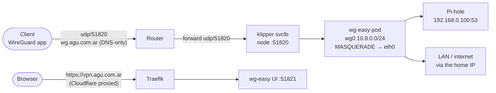

# VPN (wg-easy)

A WireGuard VPN for using the internet from outside as if from home: every
client connects to `wg.agu.com.ar:51820/udp` and all its traffic leaves through
the home IP. The official WireGuard apps for Android, Windows, Linux (and
macOS/iOS) all work. [wg-easy](https://github.com/wg-easy/wg-easy) runs the
server and an admin UI at **https://vpn.agu.com.ar** for adding devices and
showing their QR codes.

Chart: [`charts/wg-easy`](../charts/wg-easy) · App: [`apps/wg-easy.yaml`](../apps/wg-easy.yaml) ·
Backups: [backups.md](backups.md)

## How it fits together



- **Two hostnames.** `vpn.agu.com.ar` is the admin UI, proxied by Cloudflare
  like every other site. `wg.agu.com.ar` is the WireGuard endpoint and must be
  **DNS-only** (grey cloud): Cloudflare can't proxy UDP. `charts/cloudflare-ddns`
  creates it that way (`dnsOnly`). That record publishes the home IP; the web
  ports stay protected by [origin-firewall](origin-firewall.md), and WireGuard
  stays silent to any packet not signed by a known key.
- **Pod network, not hostNetwork.** wg-easy adds iptables rules (MASQUERADE,
  FORWARD) when the tunnel comes up. In its own netns they can't collide with
  the host's flannel/kube-proxy tables. Two things that needs:
  - a privileged init container sets `net.ipv4.ip_forward` and
    `src_valid_mark` in the pod's netns (they aren't "safe" sysctls, so
    `securityContext.sysctls` would need a kubelet flag);
  - the container switches its `iptables` to the **nf_tables** backend before
    starting. The image defaults to iptables-legacy, whose `ip_tables` /
    `iptable_nat` modules the Pi's kernel doesn't load (k3s uses nf_tables), so
    `wg-quick up` would fail on the first rule.
- **Full tunnel.** Clients get `AllowedIPs = 0.0.0.0/0, ::/0` and DNS
  `192.168.0.100` (Pi-hole): ad blocking and `.lan` names work from anywhere.
  There's no IPv6 in the tunnel (`DISABLE_IPV6`); `::/0` keeps the phone's IPv6
  from going around it.
- **Setup is from env, once.** `INIT_*` skips wg-easy's setup wizard on the
  first start only (host, port, DNS, AllowedIPs). After that those settings
  live in the database and are changed in the UI (Admin > Interface /
  Config), not here.

## Who can sign in

Google only, and only accounts that are already wg-easy users:

- `OAUTH_PROVIDERS=google` with the same Google OAuth client as oauth2-proxy and
  Argo CD (sealed into `wg-easy-oauth`), `OAUTH_AUTO_REGISTER=false`,
  `DISABLE_PASSWORD_AUTH=true`, `OAUTH_AUTO_LAUNCH=google`.
- wg-easy links a Google account to the user whose **email** matches, and
  rejects any other ("Auto registration is disabled").
- wg-easy has no screen to create users, so [`scripts/vpn-user.sh`](../scripts/vpn-user.sh)
  writes them into its database. The emails live only there (and in its
  backups), never in this public repo.
- The panel is deliberately **not** behind google-auth: that allowlist opens
  every dashboard, and people who only use the VPN shouldn't get them.
- The setup wizard's admin (`bootstrap`) has a random password from the
  `wg-easy-init` SealedSecret that nobody uses: password sign-in is off.

```bash
scripts/vpn-user.sh add someone@example.com       # then they sign in with Google
scripts/vpn-user.sh list                        # who, and whether they've signed in yet
scripts/vpn-user.sh remove someone@example.com
```

Every user is an admin (wg-easy has no other working role yet).

### Google OAuth client

In Google Cloud Console → APIs & Services → Credentials, the OAuth client used
by oauth2-proxy (see [secrets.md](secrets.md)) also needs these
*Authorized redirect URIs*:

- `https://vpn.agu.com.ar/api/auth/google/callback`
- `https://vpn.agu.com.ar/api/auth/google/link`

If the OAuth consent screen is still in **Testing**, every person who signs in
must be listed as a test user there.

## Adding a device

In the UI: **New client** → a name per device.

- **Android / iOS**: install *WireGuard* (WireGuard Development Team), tap
  **+** → *Scan from QR code*, and scan the client's QR in the UI. Scan it from
  INSIDE the app: the QR holds the config as text, so the phone's camera or
  Google Lens just shows that text.
- **Windows / macOS / Linux**: download the client's `.conf` from the UI.
  Windows/macOS: *WireGuard* app → *Import tunnel(s) from file*. Linux:
  `sudo cp <name>.conf /etc/wireguard/ && sudo wg-quick up <name>` (or import it
  in NetworkManager: `nmcli connection import type wireguard file <name>.conf`).

Check: on mobile data, `https://ifconfig.me` shows the home IP, and
`http://lavarropas.lan` resolves.

One client per device: two devices sharing a key keep knocking each other off.

## Metrics

wg-easy serves Prometheus metrics on the UI port, `/metrics/prometheus`: per
client (label `name`) bytes sent and received, seconds since the last
handshake, the endpoint it connects from, and configured / enabled /
connected counts (connected = a handshake in the last 10 minutes). A
VMPodScrape (`charts/wg-easy/templates/vmpodscrape.yaml`) reads them every
60 s for the **WireGuard — VPN** dashboard in Grafana (uid `wireguard`).

- The switch lives in wg-easy's database (Admin > General > Prometheus), so a
  `postStart` hook turns it on at every start (`metrics.enabled`).
- There's no bearer password, so the IngressRoute matches
  `!PathPrefix(/metrics)`: from the internet `/metrics/*` is a Traefik 404, and
  only the cluster reaches it. Don't route it: it lists every client and the
  address it connects from.
- The byte counters restart with the pod (they're WireGuard's own); the
  dashboard uses `increase()`/`rate()`, which absorb that.

## One-time setup outside git

1. **Router**: forward **UDP 51820** to the Pi (`192.168.0.100`).
2. **Pi kernel module**: load `wireguard` at boot (README step 2). Without it
   the kernel autoloads it on the first `ip link add`, but loading it up front
   doesn't depend on that.
3. **Google OAuth client**: the two redirect URIs above.
4. **Users**: `scripts/vpn-user.sh add <email>` for each person.

## Troubleshooting

- **Handshake never completes**: check the router forward and that
  `wg.agu.com.ar` is grey in Cloudflare and resolves to the current home IP
  (`dig +short wg.agu.com.ar`). favonia only sets the proxy status when it
  *creates* a record: if it ever turned orange, flip it by hand.
- **Connected but no internet**: `kubectl -n wg-easy exec deploy/wg-easy -- iptables -t nat -S POSTROUTING`
  must show the `10.8.0.0/24 … MASQUERADE` rule, and `iptables -V` must say
  `nf_tables`.
- **Some sites hang on mobile networks**: lower the MTU (Admin > Interface,
  e.g. 1280) and re-download the client config.
- **"User already linked with different account"**: that email is linked to
  another Google account. Remove and re-add the user.
- **Locked out of the UI**: `kubectl -n wg-easy exec -it deploy/wg-easy -- cli db:admin:reset`
  resets the bootstrap admin's password, but password sign-in is off; add your
  email again with `vpn-user.sh` instead.
